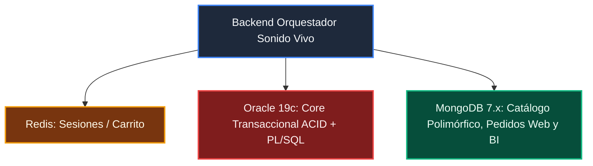

# Arquitectura NoSQL Documental y Persistencia Políglota: Sonido Vivo

**Asignatura:** Taller de Base de Datos (BDY1103)  
**Institución:** Duoc UC  
**Módulo:** Diseño e Implementación de Modelo No Relacional en MongoDB (Evaluación Parcial 3)  
**Integrantes:** Dylan Sandoval – Víctor Martínez – Danilo Sepúlveda

---

## 1. Visión de Persistencia Políglota (Oracle 19c + MongoDB 7.x + Redis)

En **Sonido Vivo** no reemplazamos el motor relacional de las entregas anteriores; aplicamos **Persistencia Políglota** para asignar cada dominio al motor donde ofrece el mejor compromiso técnico:

```text
+-----------------------------------------------------------------------------------+
|                        FRONTEND WEB / MOBILE (React + Admin)                      |
+-----------------------------------------------------------------------------------+
                                          |
                                          v
+-----------------------------------------------------------------------------------+
|                     API GATEWAY / ORQUESTADOR (FastAPI / Node.js)                 |
+-----------------------------------------------------------------------------------+
       |                                  |                                  |
       v                                  v                                  v
+--------------------+     +------------------------------+     +------------------------+
|  REDIS (Caché RAM) |     |  ORACLE DATABASE 19c (ACID)  |     |  MONGODB 7.x (BASE/CP) |
+--------------------+     +------------------------------+     +------------------------+
| - Sesiones y JWT   |     | - Tablas 3FN: CLIENTE, VENTA |     | - productos (10 docs)  |
| - Carrito efímero  |     | - PKG_SONIDO_VIVO            |     | - pedidos (Embebido)   |
| - Rate limiting    |     | - Triggers Stock & Auditoría |     | - resenas_clientes     |
|                    |     | - LOG_ERRORES (Autónomas)    |     | - Aggregation Pipeline |
+--------------------+     +------------------------------+     +------------------------+
```



---

## 2. Fundamentos para Defensa Oral (IE3.1.2)

### 2.1 Comparativa Relacional vs. No Relacional

| Criterio | Relacional (Oracle 19c) | Documental (MongoDB 7.x) |
| :--- | :--- | :--- |
| **Unidad de Almacenamiento** | Tablas bidimensionales normalizadas (3FN) con filas y columnas fijas. | Colecciones de documentos jerárquicos BSON (*Binary JSON*). |
| **Esquema** | *Schema-on-Write* (DDL previo obligatorio, columnas nulas ante variabilidad). | *Schema-on-Read* flexible, gobernable con validadores `$jsonSchema`. |
| **Consistencia** | **ACID** estricto (Atomicidad, Consistencia, Aislamiento, Durabilidad). | **BASE** (*Basically Available, Soft state, Eventual consistency*); atómico por documento. |
| **Relaciones** | Claves foráneas (`FOREIGN KEY`) + `JOIN` en tiempo de consulta. | Incrustación (subdocumentos embebidos) o referenciación lógica + `$lookup`. |
| **Escalamiento** | Vertical (*Scale-up*: mayor CPU/RAM). | Horizontal nativo (*Scale-out* mediante *Sharding*). |

### 2.2 Teorema CAP y Extensión PACELC

* **Teorema CAP (Brewer):** Ante una **Partición de Red (`P`)**, un sistema distribuido debe elegir entre **Consistencia Fuerte (`C`)** o **Disponibilidad (`A`)**.
  * **MongoDB es `CP` por defecto:** En un *Replica Set*, todas las escrituras pasan por el nodo Primario. Si ocurre un corte de red y la partición minoritaria pierde quórum, MongoDB rechaza escrituras en esos nodos para impedir estados divergentes o lecturas corruptas.
* **Extensión PACELC (Abadi):** Evaluando tanto fallos como operación normal, MongoDB es **`PC/EC`**:
  * **If Partition (`P`):** Elige Consistencia (**`C`**).
  * **Else normal (`E`):** Prioriza Consistencia (**`C`**) sincronizando el *oplog* hacia los secundarios (ajustable por operación con `Write Concern` y `Read Concern`).

---

## 3. Estrategia de Modelado Documental (IE3.2.2)

### 3.1 Anatomía BSON y Límites Estructurales
* **BSON (*Binary JSON*):** Serialización binaria nativa que añade tipos estrictos ausentes en JSON puro: `ObjectId` (12 bytes: 4B timestamp + 5B identificador aleatorio + 3B contador), `Date` UTC (64 bits), `NumberInt` (Int32), `NumberLong` (Int64) y `NumberDecimal` (Decimal128 de precisión exacta para montos CLP).
* **Límite Físico de 16 MB:** Ningún documento BSON individual puede superar **16 MB**. Protege la RAM del motor de almacenamiento *WiredTiger* y el ancho de banda de red.

### 3.2 Matriz de Decisión 1:N en Sonido Vivo

| Relación / Colección | Cardinalidad | Estrategia Aplicada | Justificación de Ingeniería |
| :--- | :--- | :--- | :--- |
| **`productos`** | Catálogo heterogéneo | **Polimorfismo en `especificaciones`** | Evita tablas EAV y columnas `NULL`: `GE001` tiene `trastes` y `configuracion_pastillas`, `TE001` tiene `teclas` y `polifonia_notas`, `AP001` tiene `patron_polar`. |
| **`pedidos`** (`cliente` + `items`) | *One-to-Few* (pocas decenas acotadas) | **Embebido** | (1) **Lectura atómica** en 1 I/O de disco sin `JOIN`; (2) **Inmutabilidad histórica**: congela `precio_unitario` y `subtotal` aunque el catálogo cambie después. |
| **`resenas_clientes`** | *One-to-Many / Squillions* | **Referenciado (`codigo_producto`)** | Evita crecimiento ilimitado (*Unbounded Growth*) dentro del producto y previene superar el tope de 16 MB BSON. |

### 3.3 Gobernanza `$jsonSchema` y Evolución con `collMod`
Las 3 colecciones en `parcial 3/ep3_sonido_vivo.js` operan con `validationLevel: "strict"` y `validationAction: "error"`. Esto bloqueó el documento inválido `BAD01` en la prueba negativa (código fuera de patrón `^[A-Z]{2}[0-9]{3}$`, categoría inválida, precio `-5000`, stock `-1`).

Para evolucionar reglas en producción sin recrear ni vaciar una colección existente se utiliza `collMod`:

```javascript
db.runCommand({
  collMod: "productos",
  validator: { /* nuevo $jsonSchema */ },
  validationLevel: "moderate" // Solo valida inserciones y modificaciones futuras
});
```

---

## 4. Catálogo de Operadores CRUD, Arrays y Rendimiento (IE3.3.2)

### 4.1 Consultas de Lectura, Paginación y `$elemMatch`
* **Dot Notation:** Navegación directa a campos anidados entre comillas (`"especificaciones.trastes": 22`, `"cliente.rut"`).
* **`$elemMatch` (Prevención de Falsos Positivos):** Exige que dos o más condiciones se cumplan simultáneamente **en el mismo elemento** del arreglo `items`:

```javascript
db.pedidos.find(
  { items: { $elemMatch: { cantidad: { $gte: 2 }, subtotal: { $gte: NumberDecimal("20000") } } } },
  { codigo_pedido: 1, "cliente.nombre": 1, items: 1, total: 1, _id: 0 }
);
// Verificado: retorna PED-2026-5002 y PED-2026-5004
```

* **Paginación eficiente de catálogo:** Uso combinado de ordenamiento y cursor:

```javascript
db.productos.find({ activo: true }).sort({ precio: -1 }).skip(0).limit(5);
```

### 4.2 Mutaciones Atómicas y Manejo de Arrays
* **Prevención de *Race Conditions* en inventario (`$inc` + guarda):** En lugar de leer en aplicación, restar y sobrescribir con `$set`, el filtro exige disponibilidad y descuenta atómicamente en motor:

```javascript
db.productos.updateOne(
  { codigo: "AP001", stock: { $gte: 2 } },
  { $inc: { stock: NumberInt(-2) } }
); // AP001 baja de 12 a 10 unidades
```

* **`$addToSet` vs. `$push`:** `$addToSet` trata el arreglo como conjunto matemático sin duplicados (`etiquetas: "alta-demanda"` en `GE001`); `$push` agrega nuevas entradas permitiendo repetición (nuevo ítem `AC001` en `PED-2026-5004`).
* **Otros operadores clave de la Unidad 3:**
  * `$pull`: Elimina elementos de un arreglo que cumplan una condición (ej. `{ $pull: { items: { codigo: "AC001" } } }`).
  * **Operador posicional `$`:** Actualiza el primer elemento coincidente dentro de un array (`"items.$.cantidad"`).
  * **`upsert: true`:** Actualiza si existe el documento filtro o inserta uno nuevo en una sola operación atómica (`db.configuraciones.updateOne(..., { upsert: true })`).

### 4.3 Índices y Diagnóstico (`IXSCAN` vs. `COLLSCAN`)

| Colección | Índice | Tipo | Objetivo |
| :--- | :--- | :--- | :--- |
| `productos` | `idx_prod_codigo` | Unique | Unicidad de código (`GA001`–`AC002`) y búsqueda O(log N) |
| `productos` | `idx_prod_cat_precio` | Compuesto (`categoria: 1, precio: -1`) | Filtrado por categoría y ordenamiento descendente |
| `productos` | `idx_prod_etiquetas_multikey` | Multikey | Indexa cada string dentro del array `etiquetas` |
| `pedidos` | `idx_ped_codigo` | Unique | Consulta instantánea por `codigo_pedido` |
| `pedidos` | `idx_ped_cliente_fecha` | Compuesto + Dot Notation | Historial por `"cliente.rut"` ordenado por fecha |
| `resenas_clientes` | `idx_res_producto` | Compuesto | Acelera `$lookup` por `codigo_producto` y orden por calificación |

Para comprobar en consola que una consulta usa índices (`IXSCAN`) y no escanea toda la colección (`COLLSCAN`), se audita con:

```javascript
db.productos.find({ codigo: "GE001" }).explain("executionStats");
```

### 4.4 Aggregation Pipelines de Negocio (Sonido Vivo)

#### Pipeline 1 — Valorización de Inventario por Categoría (`$multiply`)
Calcula el capital inmovilizado multiplicando precio unitario por stock disponible en catálogo:

```javascript
db.productos.aggregate([
  { $match: { activo: true } },
  {
    $group: {
      _id: "$categoria",
      total_productos: { $sum: 1 },
      unidades_en_stock: { $sum: "$stock" },
      valor_total_inventario: { $sum: { $multiply: ["$precio", "$stock"] } }
    }
  },
  { $sort: { valor_total_inventario: -1 } }
]);
```

#### Pipeline 2 — Facturación Consolidada por Producto (`$unwind` + `$group`, Verificado)
Ejecutado en `ep3_sonido_vivo.js` sobre pedidos `COMPLETADO` y `PAGADO` (`2.351.920 CLP` totales en 6 productos):

```javascript
db.pedidos.aggregate([
  { $match: { estado: { $in: ["COMPLETADO", "PAGADO"] } } },
  { $unwind: "$items" },
  {
    $group: {
      _id: "$items.codigo",
      nombre_producto: { $first: "$items.nombre" },
      unidades_vendidas: { $sum: "$items.cantidad" },
      ingresos_acumulados: { $sum: "$items.subtotal" }
    }
  },
  { $sort: { ingresos_acumulados: -1 } }
]);
```

#### Pipeline 3 — Cruce de Reseñas con `$lookup` (Verificado)
Realiza un *Left Outer Join* documental entre `productos` y `resenas_clientes`, consolidando promedio de estrellas redondeado en los 5 instrumentos reseñados (`GE002`, `AP001`, `AP002`: 5.0; `GE001`: 4.5; `TE001`: 4.0).
