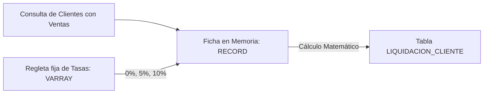
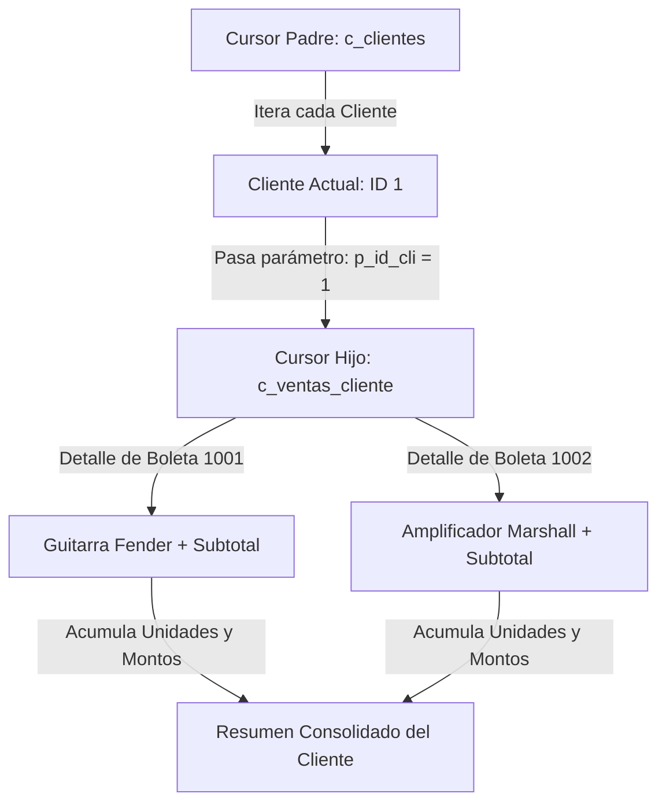
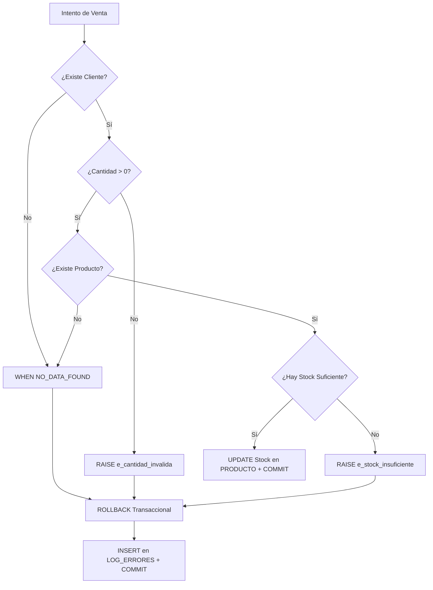
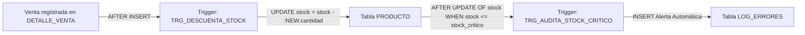

# Guía Paso a Paso: Explicación de Bloques de Código PL/SQL
## Proyecto Sonido Vivo — Tienda de Instrumentos Musicales

Bienvenido a esta guía. El objetivo de este documento es explicar, de forma **clara, cercana y paso a paso**, cómo funcionan los bloques de código PL/SQL desarrollados para el sistema de **Sonido Vivo**.

Aquí no encontrarás explicaciones rebuscadas ni tecnicismos sin sentido. Cada bloque se aborda con una analogía sencilla de la vida real, el código completo y un desglose detallado línea por línea de lo que ocurre dentro del motor de Oracle.

---

## Índice de Contenidos
1. [Bloque 1: RECORD y VARRAY — Motor de Liquidación de Clientes](#bloque-1-record-y-varray--motor-de-liquidación-de-clientes)
2. [Bloque 2: Cursores Explícitos y Anidados — Auditoría Jerárquica de Compras](#bloque-2-cursores-explícitos-y-anidados--auditoría-jerárquica-de-compras)
3. [Bloque 3: Control Integral de Excepciones — Simulador Transaccional de Venta](#bloque-3-control-integral-de-excepciones--simulador-transaccional-de-venta)
4. [Bloque 4 (Bonus): Triggers de Automatización — Descuento de Stock y Alerta Preventiva](#bloque-4-bonus-triggers-de-automatización--descuento-de-stock-y-alerta-preventiva)

---

## Bloque 1: RECORD y VARRAY — Motor de Liquidación de Clientes

### 1.1 La Idea General (Analogía Amigable)
Imagina que trabajas en la administración de la tienda en Viña del Mar y llega fin de mes. Tienes que calcular los descuentos y el saldo final de los clientes que tienen compras pendientes.

- **El `RECORD` (Registro):** Es como tener una **ficha o formulario en papel** donde agrupas todos los datos de un solo cliente en un solo lugar (su nombre, cuánto compró en total, qué porcentaje de descuento le toca, el total a cobrar, etc.). En vez de tener 10 variables sueltas por la mesa, tienes una única carpeta ordenada.
- **El `VARRAY` (Vector en Memoria):** Es como una **regleta con 3 casilleros fijos** pegada en tu escritorio:
  - Casillero 1: `0%` (clientes con compras menores a $200.000)
  - Casillero 2: `5%` (clientes de compras medias: entre $200.000 y $700.000)
  - Casillero 3: `10%` (clientes de gran volumen: sobre $700.000)
  Al tener estas tasas fijas en memoria dentro del bloque, evitas consultar tablas de configuración una y otra vez, haciendo el proceso ultra rápido.



---

### 1.2 Código del Bloque

```sql
SET SERVEROUTPUT ON SIZE UNLIMITED;

DECLARE
    -- 1. Definición del molde para la ficha del cliente (RECORD)
    TYPE t_rec_liquidacion IS RECORD (
        id_cliente          CLIENTE.id_cliente%TYPE,
        nombre_completo     VARCHAR2(120),
        tipo_cliente        CLIENTE.tipo_cliente%TYPE,
        total_bruto         NUMBER(10),
        tasa_descuento_pct  NUMBER(5,2),
        monto_descuento     NUMBER(10),
        total_neto          NUMBER(10),
        cantidad_ordenes    NUMBER(4),
        observacion         VARCHAR2(200)
    );

    -- 2. Definición del arreglo fijo de 3 posiciones para las tasas (VARRAY)
    TYPE t_arr_tasas IS VARRAY(3) OF NUMBER(5,2);

    -- 3. Instanciación de variables de trabajo
    v_liquidacion       t_rec_liquidacion;
    v_escalas_descuento t_arr_tasas := t_arr_tasas(0.00, 5.00, 10.00);
    v_contador_liq      NUMBER(8) := 0;

BEGIN
    DBMS_OUTPUT.PUT_LINE('================================================================================');
    DBMS_OUTPUT.PUT_LINE('           SONIDO VIVO — MOTOR DE LIQUIDACIÓN DE CLIENTES (RECORD + VARRAY)     ');
    DBMS_OUTPUT.PUT_LINE('================================================================================');

    -- Limpiamos la tabla de resultados para no duplicar datos
    DELETE FROM LIQUIDACION_CLIENTE;

    -- Recorremos con un cursor FOR implícito los clientes con ventas pendientes
    FOR reg_cli IN (
        SELECT c.id_cliente,
               c.nombres || ' ' || c.apellidos AS nombre_completo,
               c.tipo_cliente,
               COUNT(v.id_venta) AS cant_compras,
               NVL(SUM(v.total), 0) AS monto_acumulado
        FROM CLIENTE c
        JOIN VENTA v ON c.id_cliente = v.id_cliente
        WHERE v.estado_venta = 'PENDIENTE'
        GROUP BY c.id_cliente, c.nombres, c.apellidos, c.tipo_cliente
        ORDER BY c.id_cliente
    ) LOOP

        -- Paso A: Cargar los datos básicos en la ficha (RECORD)
        v_liquidacion.id_cliente       := reg_cli.id_cliente;
        v_liquidacion.nombre_completo  := reg_cli.nombre_completo;
        v_liquidacion.tipo_cliente     := reg_cli.tipo_cliente;
        v_liquidacion.total_bruto      := reg_cli.monto_acumulado;
        v_liquidacion.cantidad_ordenes := reg_cli.cant_compras;

        -- Paso B: Consultar la regleta (VARRAY) según el monto bruto
        IF v_liquidacion.total_bruto < 200000 THEN
            v_liquidacion.tasa_descuento_pct := v_escalas_descuento(1); -- 0%
            v_liquidacion.observacion        := 'Tramo Inicial: Sin descuento adicional por volumen';
        ELSIF v_liquidacion.total_bruto BETWEEN 200000 AND 700000 THEN
            v_liquidacion.tasa_descuento_pct := v_escalas_descuento(2); -- 5%
            v_liquidacion.observacion        := 'Tramo Plata: 5% descuento por volumen de compra';
        ELSE
            v_liquidacion.tasa_descuento_pct := v_escalas_descuento(3); -- 10%
            v_liquidacion.observacion        := 'Tramo Oro: 10% beneficio preferencial por gran volumen';
        END IF;

        -- Paso C: Bonificación adicional para clientes PREMIUM (+2%)
        IF v_liquidacion.tipo_cliente = 'PREMIUM' THEN
            v_liquidacion.tasa_descuento_pct := v_liquidacion.tasa_descuento_pct + 2.00;
            v_liquidacion.observacion        := v_liquidacion.observacion || ' (+2% fidelidad PREMIUM)';
        END IF;

        -- Paso D: Matemáticas en memoria
        v_liquidacion.monto_descuento := ROUND(v_liquidacion.total_bruto * (v_liquidacion.tasa_descuento_pct / 100));
        v_liquidacion.total_neto      := v_liquidacion.total_bruto - v_liquidacion.monto_descuento;

        -- Paso E: Guardar la liquidación en la base de datos
        INSERT INTO LIQUIDACION_CLIENTE (
            id_liquidacion,
            id_cliente,
            nombre_completo,
            total_bruto,
            tasa_descuento_pct,
            monto_descuento,
            total_neto,
            cantidad_compras,
            fecha_liquidacion,
            observacion
        ) VALUES (
            SEQ_LIQUIDACION_CLIENTE.NEXTVAL,
            v_liquidacion.id_cliente,
            v_liquidacion.nombre_completo,
            v_liquidacion.total_bruto,
            v_liquidacion.tasa_descuento_pct,
            v_liquidacion.monto_descuento,
            v_liquidacion.total_neto,
            v_liquidacion.cantidad_ordenes,
            SYSDATE,
            v_liquidacion.observacion
        );

        -- Paso F: Mostrar en consola para verificar
        DBMS_OUTPUT.PUT_LINE('Cliente: ' || RPAD(v_liquidacion.nombre_completo, 30) ||
                             ' | Bruto: $' || LPAD(TO_CHAR(v_liquidacion.total_bruto, '999G999G999'), 12) ||
                             ' | Tasa: ' || LPAD(TO_CHAR(v_liquidacion.tasa_descuento_pct, '90.00'), 6) || '%' ||
                             ' | Neto: $' || LPAD(TO_CHAR(v_liquidacion.total_neto, '999G999G999'), 12));

        v_contador_liq := v_contador_liq + 1;

    END LOOP;

    -- Confirmamos los cambios de forma permanente
    COMMIT;
    DBMS_OUTPUT.PUT_LINE('--------------------------------------------------------------------------------');
    DBMS_OUTPUT.PUT_LINE('>> PROCESO FINALIZADO: ' || v_contador_liq || ' liquidaciones calculadas y guardadas.');
    DBMS_OUTPUT.PUT_LINE('================================================================================');

END;
/
```

---

### 1.3 Explicación Línea por Línea

| Líneas | Instrucción / Código | ¿Qué hace y por qué se hizo así? |
| :--- | :--- | :--- |
| **8** | `SET SERVEROUTPUT ON SIZE UNLIMITED;` | Activa la consola de Oracle para que podamos ver los mensajes de `DBMS_OUTPUT.PUT_LINE` sin quedarnos sin espacio en el búfer. |
| **10** | `DECLARE` | Abre la sección declarativa. Aquí definimos los tipos de datos y reservamos las variables en memoria antes de ejecutar cualquier cálculo. |
| **16-26** | `TYPE t_rec_liquidacion IS RECORD (...)` | Creamos el **molde** de una estructura compuesta llamada `RECORD`. Permite que una sola variable contenga campos de distinto tipo (`id_cliente`, texto, números con decimales, fechas). Usamos `CLIENTE.id_cliente%TYPE` para que, si el tipo de columna cambia en la tabla, el código no se rompa (integridad dinámica). |
| **32** | `TYPE t_arr_tasas IS VARRAY(3) OF NUMBER(5,2);` | Creamos el molde de un arreglo de tamaño fijo (3 casillas) para almacenar números decimales. Un `VARRAY` es ideal cuando la cantidad máxima de elementos es conocida de antemano y no va a cambiar durante el bloque. |
| **37** | `v_liquidacion t_rec_liquidacion;` | Creamos la variable real basada en el molde `RECORD` para guardar los datos del cliente actual en cada vuelta del ciclo. |
| **38** | `v_escalas_descuento t_arr_tasas := t_arr_tasas(0.00, 5.00, 10.00);` | Instanciamos el `VARRAY` pasándole directamente sus 3 valores iniciales: Tramo 1 = 0%, Tramo 2 = 5%, Tramo 3 = 10%. |
| **39** | `v_contador_liq NUMBER(8) := 0;` | Un simple acumulador para contar cuántos clientes fueron procesados al final. |
| **41** | `BEGIN` | Marca el inicio de la zona ejecutable (las acciones reales). |
| **47** | `DELETE FROM LIQUIDACION_CLIENTE;` | Limpia los registros anteriores para evitar duplicar cálculos si ejecutamos el script más de una vez. |
| **50-60** | `FOR reg_cli IN (SELECT ... WHERE estado_venta = 'PENDIENTE' ...) LOOP` | Cursor `FOR` implícito. Consulta a los clientes que tienen ventas en estado 'PENDIENTE', suma sus montos (`NVL(SUM(v.total), 0)`) y agrupa. Oracle abre, itera y cierra este cursor automáticamente, guardando cada fila en el registro `reg_cli`. |
| **64-68** | `v_liquidacion.id_cliente := reg_cli.id_cliente; ...` | Asignamos los datos obtenidos de la consulta SQL directamente a los campos internos de nuestro `RECORD`. Se usa la sintaxis `variable.campo`. |
| **71-80** | `IF ... THEN v_escalas_descuento(1) ... ELSIF ...` | Evaluamos el monto total acumulado y extraemos la tasa correspondiente desde el `VARRAY` usando sus índices numéricos `(1)`, `(2)` o `(3)`. En Oracle los arreglos empiezan en índice 1 (no en 0). |
| **83-86** | `IF v_liquidacion.tipo_cliente = 'PREMIUM' THEN ... + 2.00;` | Regla de negocio adicional: si el cliente tiene categoría 'PREMIUM', se le suma un 2% extra sobre la tasa ya asignada y se deja constancia en el campo `observacion`. |
| **89-90** | `v_liquidacion.monto_descuento := ROUND(...)` | Calculamos el dinero a descontar multiplicando el total bruto por el porcentaje dividido en 100, redondeando al entero más cercano con `ROUND`. Luego restamos para obtener el `total_neto`. |
| **93-115** | `INSERT INTO LIQUIDACION_CLIENTE (...) VALUES (SEQ_LIQUIDACION_CLIENTE.NEXTVAL, ...)` | Insertamos la liquidación final en la tabla física. Usamos una **secuencia de Oracle** (`NEXTVAL`) para generar la clave primaria de forma atómica y segura, evitando colisiones en entornos multiusuario. |
| **118-121** | `DBMS_OUTPUT.PUT_LINE(...)` | Imprimimos el resultado con formato amigable. Usamos `RPAD` y `LPAD` para alinear columnas y `TO_CHAR(..., '999G999G999')` para formatear los números con separador de miles. |
| **125** | `END LOOP;` | Cierra la iteración del cliente actual y pasa automáticamente al siguiente. |
| **127** | `COMMIT;` | Aplica y confirma todas las inserciones de forma definitiva en la base de datos bajo los principios de consistencia ACID. |
| **132** | `END; /` | Cierra el bloque anónimo PL/SQL y la barra inclinada `/` le dice a SQL Developer o SQL*Plus que lo compile y ejecute. |

---

## Bloque 2: Cursores Explícitos y Anidados — Auditoría Jerárquica de Compras

### 2.1 La Idea General (Analogía Amigable)
Imagina que vas a una biblioteca y necesitas revisar todas las boletas de cada cliente para hacer una auditoría completa:

- **Bucle Externo (Cursor Padre):** Es como sacar del estante la carpeta de cada **Cliente** que tenga compras registradas. Tomas la primera carpeta: "Carlos Valenzuela".
- **Bucle Interno (Cursor Hijo Parametrizado):** Abres la carpeta de Carlos y sacas una lista detallada con **todas las boletas y productos** que compró Carlos (guitarras, cables, amplificadores). ¿Cómo sabe el cursor hijo qué buscar? Porque le pasamos como parámetro el `id_cliente` de Carlos (`p_id_cli`).
- Una vez que terminas de leer y sumar todo lo de Carlos, cierras su carpeta, anotas el total general y pasas a la carpeta del siguiente cliente.



---

### 2.2 Código del Bloque

```sql
SET SERVEROUTPUT ON SIZE UNLIMITED;

DECLARE
    -- 1. Cursor Padre: Clientes que tienen al menos una venta registrada
    CURSOR c_clientes IS
        SELECT c.id_cliente,
               c.rut,
               c.nombres || ' ' || c.apellidos AS cliente_nombre,
               c.comuna,
               c.tipo_cliente
        FROM CLIENTE c
        WHERE EXISTS (
            SELECT 1 
            FROM VENTA v 
            WHERE v.id_cliente = c.id_cliente
        )
        ORDER BY c.id_cliente;

    -- 2. Cursor Hijo con Parámetro: Detalle de productos comprados por el cliente
    CURSOR c_ventas_cliente (p_id_cli CLIENTE.id_cliente%TYPE) IS
        SELECT v.nro_boleta,
               v.fecha_venta,
               p.codigo AS codigo_prod,
               p.nombre AS nombre_prod,
               cat.nombre_categoria,
               d.cantidad,
               d.precio_unitario,
               d.subtotal_linea
        FROM VENTA v
        JOIN DETALLE_VENTA d ON v.id_venta = d.id_venta
        JOIN PRODUCTO p      ON d.id_producto = p.id_producto
        JOIN CATEGORIA cat   ON p.id_categoria = cat.id_categoria
        WHERE v.id_cliente = p_id_cli
        ORDER BY v.nro_boleta, d.id_detalle;

    -- 3. Variables para acumuladores y cortes de control
    v_total_cliente       NUMBER(10);
    v_total_unidades      NUMBER(6);
    v_boleta_actual       NUMBER(8);
    v_contador_clientes   NUMBER(4) := 0;

BEGIN
    DBMS_OUTPUT.PUT_LINE('================================================================================');
    DBMS_OUTPUT.PUT_LINE('     SONIDO VIVO — AUDITORÍA DETALLADA DE COMPRAS POR CLIENTE (CURSORES)        ');
    DBMS_OUTPUT.PUT_LINE('================================================================================');

    -- BUCLE EXTERNO: Recorre cada cliente uno por uno
    FOR reg_cli IN c_clientes LOOP
        v_contador_clientes := v_contador_clientes + 1;
        v_total_cliente     := 0;
        v_total_unidades    := 0;
        v_boleta_actual     := 0;

        -- Encabezado del cliente
        DBMS_OUTPUT.PUT_LINE('--------------------------------------------------------------------------------');
        DBMS_OUTPUT.PUT_LINE('CLIENTE [' || reg_cli.id_cliente || '] ' || UPPER(reg_cli.cliente_nombre) || 
                             ' | RUT: ' || reg_cli.rut || 
                             ' | Comuna: ' || reg_cli.comuna || 
                             ' | Categoría: ' || reg_cli.tipo_cliente);
        DBMS_OUTPUT.PUT_LINE('--------------------------------------------------------------------------------');

        -- BUCLE INTERNO: Recorre los productos del cliente actual usando su ID como parámetro
        FOR reg_det IN c_ventas_cliente(reg_cli.id_cliente) LOOP
            
            -- Corte de control visual: si cambiamos de boleta, mostramos el encabezado de boleta
            IF v_boleta_actual <> reg_det.nro_boleta THEN
                v_boleta_actual := reg_det.nro_boleta;
                DBMS_OUTPUT.PUT_LINE('  >> Boleta N° ' || v_boleta_actual || ' (Emitida: ' || TO_CHAR(reg_det.fecha_venta, 'DD/MM/YYYY') || '):');
            END IF;

            -- Línea de detalle del producto adquirido
            DBMS_OUTPUT.PUT_LINE('     * [' || reg_det.codigo_prod || '] ' || 
                                 RPAD(reg_det.nombre_prod, 32) || 
                                 ' (' || RPAD(reg_det.nombre_categoria, 18) || ') ' ||
                                 ' | Cant: ' || LPAD(reg_det.cantidad, 2) || 
                                 ' x $' || LPAD(TO_CHAR(reg_det.precio_unitario, '999G999'), 9) || 
                                 ' = $' || LPAD(TO_CHAR(reg_det.subtotal_linea, '999G999'), 9));

            -- Acumulamos unidades físicas y dinero gastado
            v_total_cliente  := v_total_cliente + reg_det.subtotal_linea;
            v_total_unidades := v_total_unidades + reg_det.cantidad;

        END LOOP; -- Fin del bucle de productos

        -- Resumen final consolidado de este cliente
        DBMS_OUTPUT.PUT_LINE('  --> RESUMEN CLIENTE: ' || v_total_unidades || ' unidades adquiridas | Total Acumulado: $' || 
                             TO_CHAR(v_total_cliente, '999G999G999'));

    END LOOP; -- Fin del bucle de clientes

    DBMS_OUTPUT.PUT_LINE('================================================================================');
    DBMS_OUTPUT.PUT_LINE('>> PROCESAMIENTO COMPLETADO: ' || v_contador_clientes || ' clientes auditados con éxito.');
    DBMS_OUTPUT.PUT_LINE('================================================================================');

END;
/
```

---

### 2.3 Explicación Línea por Línea

| Líneas | Instrucción / Código | ¿Qué hace y por qué se hizo así? |
| :--- | :--- | :--- |
| **16-28** | `CURSOR c_clientes IS SELECT ... WHERE EXISTS (...)` | Declara el cursor principal explícito. La cláusula `WHERE EXISTS` es una optimización arquitectónica clave: filtra directamente a los clientes que poseen al menos una venta, evitando traer clientes vacíos a la memoria. |
| **32** | `CURSOR c_ventas_cliente (p_id_cli CLIENTE.id_cliente%TYPE) IS ...` | Declara el cursor secundario **parametrizado**. Recibe el identificador del cliente (`p_id_cli`) y ejecuta un `JOIN` entre 4 tablas (`VENTA`, `DETALLE_VENTA`, `PRODUCTO`, `CATEGORIA`) para recuperar solo lo que le pertenece a ese cliente específico. |
| **49-52** | `v_total_cliente NUMBER(10); ...` | Variables de soporte numérico para acumular subtotales y unidades por cliente, y llevar el registro de qué boleta se está imprimiendo actualmente. |
| **62** | `FOR reg_cli IN c_clientes LOOP` | Inicio del **bucle externo**. El cursor `FOR LOOP` de Oracle gestiona automáticamente las operaciones `OPEN`, `FETCH` y `CLOSE` del cursor `c_clientes`. Cada fila queda disponible en el registro `reg_cli`. |
| **64-66** | `v_total_cliente := 0; v_total_unidades := 0; ...` | **Punto crítico:** Reiniciamos los acumuladores a cero al entrar a cada cliente, garantizando que los totales del cliente anterior no se sumen al cliente nuevo. |
| **68-73** | `DBMS_OUTPUT.PUT_LINE('CLIENTE [' || ...)` | Muestra en pantalla la cabecera del cliente (Nombre completo con `UPPER`, RUT, Comuna y Tipo de Cliente). |
| **78** | `FOR reg_det IN c_ventas_cliente(reg_cli.id_cliente) LOOP` | Inicio del **bucle interno**. Aquí ocurre la magia del cursor anidado: invocamos al cursor hijo pasándole como argumento `reg_cli.id_cliente`. Oracle abre el cursor secundario filtrado únicamente para ese cliente. |
| **81-84** | `IF v_boleta_actual <> reg_det.nro_boleta THEN ...` | **Técnica de Corte de Control:** Si el número de boleta del producto actual es distinto al anterior, imprimimos un subtítulo con el número de boleta y su fecha de emisión. Evitamos repetir el encabezado en cada producto de una misma boleta. |
| **87-92** | `DBMS_OUTPUT.PUT_LINE(' * [' || reg_det.codigo_prod ...)` | Imprime la línea de compra: código de producto, nombre (alineado con `RPAD`), categoría entre paréntesis, cantidad comprada, precio unitario y subtotal formateado con moneda. |
| **95-96** | `v_total_cliente := v_total_cliente + reg_det.subtotal_linea;` | Suma aritmética acumulativa: agrega el subtotal de la línea al total general del cliente y la cantidad de unidades al conteo físico. |
| **98** | `END LOOP;` | Fin del bucle interno. Oracle cierra automáticamente el cursor hijo y libera la memoria de los detalles. |
| **101-102** | `DBMS_OUTPUT.PUT_LINE(' --> RESUMEN CLIENTE: ' || ...)` | Muestra el balance final del cliente: total de unidades compradas y total de dinero acumulado en todas sus boletas. |
| **104** | `END LOOP;` | Fin del bucle externo. Pasa al siguiente cliente del cursor `c_clientes`. |

---

## Bloque 3: Control Integral de Excepciones — Simulador Transaccional de Venta

### 3.1 La Idea General (Analogía Amigable)
Imagina que eres el cajero de Sonido Vivo y un cliente quiere comprar 5 unidades de una guitarra eléctrica Gibson Les Paul. Antes de pasar la tarjeta o descontar la mercadería del sistema, tienes que hacer controles de seguridad:

1. **¿Existe el cliente en la base de datos?** Si buscas el RUT o ID y no existe, Oracle dispara automáticamente el error `NO_DATA_FOUND`.
2. **¿La cantidad pedida tiene sentido?** Si el cliente pide `-2` o `0` guitarras, es una falta a las reglas de negocio. Disparamos una excepción personalizada: `e_cantidad_invalida`.
3. **¿Existe la guitarra solicitada?** Si pones el código `GE002` y no existe, salta de nuevo `NO_DATA_FOUND`.
4. **¿Tenemos suficiente stock en la bodega de Viña del Mar?** Si pide 5 guitarras y solo quedan 2 en bodega, no podemos vender lo que no tenemos. Disparamos nuestra excepción personalizada: `e_stock_insuficiente`.

Si **cualquier** control falla, el bloque detiene la venta de inmediato, cancela cualquier cambio con `ROLLBACK` y escribe automáticamente una entrada en la tabla `LOG_ERRORES` para que el administrador sepa qué pasó. Si todo está en orden, descuenta el stock y confirma con `COMMIT`.



---

### 3.2 Código del Bloque

```sql
SET SERVEROUTPUT ON SIZE UNLIMITED;

DECLARE
    -- 1. Excepciones definidas por el usuario (Reglas de Negocio)
    e_stock_insuficiente    EXCEPTION;
    e_cantidad_invalida     EXCEPTION;

    -- Parámetros simulados (Prueba: Carlos Valenzuela compra 5 Gibson Les Paul con stock 2)
    v_id_cliente_solicitado  NUMBER := 1;
    v_codigo_prod_solicitado VARCHAR2(10) := 'GE002';
    v_cantidad_solicitada    NUMBER := 5; -- Forzamos error de stock (cambiar a <=2 para éxito)

    -- Variables para guardar datos consultados
    v_id_producto   PRODUCTO.id_producto%TYPE;
    v_nombre_prod   PRODUCTO.nombre%TYPE;
    v_precio_prod   PRODUCTO.precio%TYPE;
    v_stock_actual  PRODUCTO.stock%TYPE;
    v_stock_critico PRODUCTO.stock_critico%TYPE;
    v_rut_cliente   CLIENTE.rut%TYPE;
    v_nombre_cli    CLIENTE.nombres%TYPE;
    
    -- Variables para auditoría de errores
    v_secuencia_log NUMBER(8);
    v_cod_error     VARCHAR2(50);
    v_msj_error     VARCHAR2(400);

BEGIN
    DBMS_OUTPUT.PUT_LINE('================================================================================');
    DBMS_OUTPUT.PUT_LINE('     SONIDO VIVO — SIMULADOR TRANSACCIONAL CON CONTROL DE EXCEPCIONES           ');
    DBMS_OUTPUT.PUT_LINE('================================================================================');

    -- CONTROL 1: Verificar existencia del cliente
    SELECT rut, nombres
    INTO v_rut_cliente, v_nombre_cli
    FROM CLIENTE
    WHERE id_cliente = v_id_cliente_solicitado;

    DBMS_OUTPUT.PUT_LINE('>> Cliente Verificado: ' || v_nombre_cli || ' (RUT: ' || v_rut_cliente || ')');

    -- CONTROL 2: Validar cantidad estrictamente positiva
    IF v_cantidad_solicitada <= 0 THEN
        RAISE e_cantidad_invalida;
    END IF;

    -- CONTROL 3: Verificar existencia del producto y consultar su stock
    SELECT id_producto, nombre, precio, stock, stock_critico
    INTO v_id_producto, v_nombre_prod, v_precio_prod, v_stock_actual, v_stock_critico
    FROM PRODUCTO
    WHERE codigo = v_codigo_prod_solicitado;

    DBMS_OUTPUT.PUT_LINE('>> Producto Seleccionado: ' || v_nombre_prod || 
                         ' | Stock en Bodega: ' || v_stock_actual || 
                         ' | Cantidad Pedida: ' || v_cantidad_solicitada);

    -- CONTROL 4: Validar disponibilidad de stock
    IF v_cantidad_solicitada > v_stock_actual THEN
        RAISE e_stock_insuficiente;
    END IF;

    -- SI TODO PASÓ: Descontar stock físicamente
    UPDATE PRODUCTO
    SET stock = stock - v_cantidad_solicitada
    WHERE id_producto = v_id_producto;

    DBMS_OUTPUT.PUT_LINE('>> ÉXITO: Stock descontado en tabla PRODUCTO (' || 
                         v_stock_actual || ' -> ' || (v_stock_actual - v_cantidad_solicitada) || 
                         ' unidades). Venta completada satisfactoriamente.');
    COMMIT;

EXCEPTION
    -- Captura error nativo: Cliente o producto no encontrado en SELECT INTO
    WHEN NO_DATA_FOUND THEN
        ROLLBACK;
        v_secuencia_log := SEQ_LOG_ERRORES.NEXTVAL;
        v_cod_error := 'ORA-01403 (NO_DATA_FOUND)';
        v_msj_error := 'Error de búsqueda: El cliente ID ' || v_id_cliente_solicitado || 
                       ' o el producto código ' || v_codigo_prod_solicitado || ' no existen en el sistema.';
        
        INSERT INTO LOG_ERRORES (id_log, codigo_error, mensaje_error, modulo_origen, usuario_bd, fecha_registro)
        VALUES (v_secuencia_log, v_cod_error, v_msj_error, 'MODULO_VENTAS_CHECKOUT', USER, SYSDATE);
        COMMIT;

        DBMS_OUTPUT.PUT_LINE('[EXCEPCIÓN ORACLE CAPTURADA]: ' || v_msj_error);
        DBMS_OUTPUT.PUT_LINE('>> Incidente auditado en LOG_ERRORES con ID: ' || v_secuencia_log);

    -- Captura error nativo: Duplicidad en identificador
    WHEN TOO_MANY_ROWS THEN
        ROLLBACK;
        v_secuencia_log := SEQ_LOG_ERRORES.NEXTVAL;
        v_cod_error := 'ORA-01422 (TOO_MANY_ROWS)';
        v_msj_error := 'Inconsistencia de catálogo: Se encontró más de un registro para el identificador consultado.';
        
        INSERT INTO LOG_ERRORES (id_log, codigo_error, mensaje_error, modulo_origen, usuario_bd, fecha_registro)
        VALUES (v_secuencia_log, v_cod_error, v_msj_error, 'MODULO_VENTAS_CHECKOUT', USER, SYSDATE);
        COMMIT;

        DBMS_OUTPUT.PUT_LINE('[EXCEPCIÓN ORACLE CAPTURADA]: ' || v_msj_error);
        DBMS_OUTPUT.PUT_LINE('>> Incidente auditado en LOG_ERRORES con ID: ' || v_secuencia_log);

    -- Captura excepción de negocio: Stock insuficiente
    WHEN e_stock_insuficiente THEN
        ROLLBACK;
        v_secuencia_log := SEQ_LOG_ERRORES.NEXTVAL;
        v_cod_error := 'USR-001 (STOCK_INSUFICIENTE)';
        v_msj_error := 'Operación rechazada: No es posible vender ' || v_cantidad_solicitada || 
                       ' unidades del producto ' || v_nombre_prod || '. Stock disponible: ' || v_stock_actual || '.';
        
        INSERT INTO LOG_ERRORES (id_log, codigo_error, mensaje_error, modulo_origen, usuario_bd, fecha_registro)
        VALUES (v_secuencia_log, v_cod_error, v_msj_error, 'MODULO_VENTAS_STOCK', USER, SYSDATE);
        COMMIT;

        DBMS_OUTPUT.PUT_LINE('[EXCEPCIÓN DE NEGOCIO CAPTURADA]: ' || v_msj_error);
        DBMS_OUTPUT.PUT_LINE('>> Incidente auditado en LOG_ERRORES con ID: ' || v_secuencia_log);

    -- Captura excepción de negocio: Cantidad pedida <= 0
    WHEN e_cantidad_invalida THEN
        ROLLBACK;
        v_secuencia_log := SEQ_LOG_ERRORES.NEXTVAL;
        v_cod_error := 'USR-002 (CANTIDAD_INVALIDA)';
        v_msj_error := 'Operación rechazada: La cantidad a comprar debe ser un entero estrictamente mayor a cero.';
        
        INSERT INTO LOG_ERRORES (id_log, codigo_error, mensaje_error, modulo_origen, usuario_bd, fecha_registro)
        VALUES (v_secuencia_log, v_cod_error, v_msj_error, 'MODULO_VENTAS_PARAMETROS', USER, SYSDATE);
        COMMIT;

        DBMS_OUTPUT.PUT_LINE('[EXCEPCIÓN DE NEGOCIO CAPTURADA]: ' || v_msj_error);
        DBMS_OUTPUT.PUT_LINE('>> Incidente auditado en LOG_ERRORES con ID: ' || v_secuencia_log);

    -- Captura general de cualquier imprevisto técnico
    WHEN OTHERS THEN
        ROLLBACK;
        v_secuencia_log := SEQ_LOG_ERRORES.NEXTVAL;
        v_cod_error := 'ORA-' || TO_CHAR(SQLCODE);
        v_msj_error := SUBSTR(SQLERRM, 1, 380);
        
        INSERT INTO LOG_ERRORES (id_log, codigo_error, mensaje_error, modulo_origen, usuario_bd, fecha_registro)
        VALUES (v_secuencia_log, v_cod_error, v_msj_error, 'MODULO_VENTAS_GENERAL', USER, SYSDATE);
        COMMIT;

        DBMS_OUTPUT.PUT_LINE('[ERROR NO CONTROLADO]: ' || v_msj_error);
        DBMS_OUTPUT.PUT_LINE('>> Incidente auditado en LOG_ERRORES con ID: ' || v_secuencia_log);

END;
/
```

---

### 3.3 Explicación Línea por Línea

| Líneas | Instrucción / Código | ¿Qué hace y por qué se hizo así? |
| :--- | :--- | :--- |
| **14-15** | `e_stock_insuficiente EXCEPTION; e_cantidad_invalida EXCEPTION;` | Declaramos nombres personalizados de excepciones. En Oracle, una excepción creada por el desarrollador se define como tipo `EXCEPTION` para usarla luego con la palabra clave `RAISE`. |
| **18-20** | `v_id_cliente_solicitado ... v_cantidad_solicitada := 5;` | Variables simuladas que representan los datos ingresados en el carrito de compras o en la caja física. |
| **44-47** | `SELECT rut, nombres INTO v_rut_cliente, v_nombre_cli FROM CLIENTE ...` | Primera consulta `SELECT INTO`. Si el ID del cliente no existe en la tabla `CLIENTE`, Oracle detiene el flujo normal de inmediato y salta directo a la sección `EXCEPTION` bajo `WHEN NO_DATA_FOUND`. |
| **54-56** | `IF v_cantidad_solicitada <= 0 THEN RAISE e_cantidad_invalida; END IF;` | Control de integridad de parámetros: si la cantidad solicitada es menor o igual a cero, ejecutamos `RAISE e_cantidad_invalida`, lo que interrumpe la ejecución e invoca su manejador de excepción. |
| **61-64** | `SELECT id_producto, ... INTO ... FROM PRODUCTO WHERE codigo = ...` | Segunda consulta `SELECT INTO`. Si el código de producto no existe, también gatilla `NO_DATA_FOUND`. Si existe, carga en memoria el stock real disponible en la tienda. |
| **73-75** | `IF v_cantidad_solicitada > v_stock_actual THEN RAISE e_stock_insuficiente; END IF;` | **Regla de oro de inventario:** Comparamos lo solicitado contra el stock en bodega. Si piden más de lo que hay, disparamos `RAISE e_stock_insuficiente`. |
| **80-82** | `UPDATE PRODUCTO SET stock = stock - v_cantidad_solicitada ...` | Si todas las validaciones pasaron limpias, descontamos las unidades del producto. |
| **87** | `COMMIT;` | Cerramos la transacción confirmando los cambios en disco. |
| **89** | `EXCEPTION` | Marca el inicio de la zona de control de errores. |
| **93-94** | `WHEN NO_DATA_FOUND THEN ROLLBACK;` | Si falló cualquier `SELECT INTO`, ejecutamos `ROLLBACK` para deshacer cualquier modificación pendiente en la sesión. |
| **95** | `v_secuencia_log := SEQ_LOG_ERRORES.NEXTVAL;` | Obtenemos el próximo identificador numérico correlativo de la secuencia `SEQ_LOG_ERRORES`. |
| **100-102** | `INSERT INTO LOG_ERRORES (...) VALUES (...); COMMIT;` | Registramos el incidente en la tabla de auditoría con la fecha (`SYSDATE`), el usuario conectado (`USER`) y el mensaje descriptivo. Aplicamos `COMMIT` para que la bitácora quede guardada aunque la venta principal se haya cancelado. |
| **107-119** | `WHEN TOO_MANY_ROWS THEN ...` | Se activa si una consulta `SELECT INTO` devuelve más de una fila, lo que indicaría claves primarias duplicadas o fallas de integridad en los datos. |
| **123-136** | `WHEN e_stock_insuficiente THEN ...` | Capturador de nuestra excepción de stock. Asigna el código `'USR-001'` y graba en el log detallando exactamente cuántas unidades se pidieron y cuántas había en bodega. |
| **137-149** | `WHEN e_cantidad_invalida THEN ...` | Capturador de la cantidad `<= 0`. Asigna el código `'USR-002'` y registra la falta. |
| **153-165** | `WHEN OTHERS THEN ... SQLCODE ... SQLERRM` | El salvavidas final: captura cualquier otro error inesperado que no hayamos previsto. `SQLCODE` entrega el número del error de Oracle y `SQLERRM` su descripción en texto (truncada con `SUBSTR` a 380 caracteres para no desbordar la columna). |

---

## Bloque 4 (Bonus): Triggers de Automatización — Descuento de Stock y Alerta Preventiva

### 4.1 La Idea General (Analogía Amigable)
Imagina que en vez de acordarte manualmente de descontar el stock cada vez que se emite una boleta, instalas un **sensor automático**:
- **Trigger 1 (`TRG_DESCUENTA_STOCK`):** Apenas se inserta una fila en `DETALLE_VENTA` (se vendió una guitarra), el trigger automáticamente va a la tabla `PRODUCTO` y le resta la cantidad al stock.
- **Trigger 2 (`TRG_AUDITA_STOCK_CRITICO`):** Cuando el stock de un producto se actualiza y baja hasta ser menor o igual a su `stock_critico` (por ejemplo, quedan solo 2 guitarras), el trigger hace sonar una alarma silenciosa e inserta una alerta de reabastecimiento en `LOG_ERRORES`.



---

### 4.2 Código de los Triggers

```sql
SET SERVEROUTPUT ON SIZE UNLIMITED;

-- ============================================================================
-- 1. TRIGGER: TRG_DESCUENTA_STOCK
-- ============================================================================
CREATE OR REPLACE TRIGGER TRG_DESCUENTA_STOCK
AFTER INSERT ON DETALLE_VENTA
FOR EACH ROW
BEGIN
    UPDATE PRODUCTO
    SET stock = stock - :NEW.cantidad
    WHERE id_producto = :NEW.id_producto;
END;
/

-- ============================================================================
-- 2. TRIGGER: TRG_AUDITA_STOCK_CRITICO
-- ============================================================================
CREATE OR REPLACE TRIGGER TRG_AUDITA_STOCK_CRITICO
AFTER UPDATE OF stock ON PRODUCTO
FOR EACH ROW
WHEN (NEW.stock <= NEW.stock_critico)
BEGIN
    INSERT INTO LOG_ERRORES (
        id_log,
        codigo_error,
        mensaje_error,
        modulo_origen,
        usuario_bd,
        fecha_registro
    ) VALUES (
        SEQ_LOG_ERRORES.NEXTVAL,
        'ALERTA-STOCK-CRITICO',
        'ATENCIÓN: El producto ID ' || :NEW.id_producto || ' (' || :NEW.nombre || 
        ') ha alcanzado nivel crítico. Stock restante: ' || :NEW.stock || 
        ' (Umbral mínimo: ' || :NEW.stock_critico || '). Requiere reposición en Viña del Mar.',
        'TRIGGER_AUDITA_STOCK_CRITICO',
        USER,
        SYSDATE
    );
END;
/
```

---

### 4.3 Explicación Línea por Línea

| Líneas | Instrucción / Código | ¿Qué hace y por qué se hizo así? |
| :--- | :--- | :--- |
| **17** | `CREATE OR REPLACE TRIGGER TRG_DESCUENTA_STOCK` | Crea o reemplaza el trigger llamado `TRG_DESCUENTA_STOCK`. Al usar `OR REPLACE` evitamos errores si el trigger ya existía previamente. |
| **18** | `AFTER INSERT ON DETALLE_VENTA` | Define el evento disparador: se ejecuta **después** (`AFTER`) de que una nueva fila ha sido insertada exitosamente en la tabla `DETALLE_VENTA`. |
| **19** | `FOR EACH ROW` | Indica que es un **trigger de fila**. Si una venta inserta 3 productos diferentes en `DETALLE_VENTA`, el trigger se disparará 3 veces, una por cada producto. |
| **21-23** | `UPDATE PRODUCTO SET stock = stock - :NEW.cantidad WHERE id_producto = :NEW.id_producto;` | Modifica la tabla `PRODUCTO`. El prefijo `:NEW` hace referencia a los valores de la fila recién insertada en `DETALLE_VENTA`. **Nota de arquitectura:** Como el trigger está sobre `DETALLE_VENTA` y modifica `PRODUCTO`, jamás sufrirá del famoso error de tabla mutante (`ORA-04091`). |
| **33** | `CREATE OR REPLACE TRIGGER TRG_AUDITA_STOCK_CRITICO` | Crea el segundo trigger para la vigilancia proactiva del inventario. |
| **34** | `AFTER UPDATE OF stock ON PRODUCTO` | Se activa **únicamente** cuando la columna `stock` de la tabla `PRODUCTO` es modificada (evita dispararse si solo le cambiamos el precio o el nombre al producto). |
| **36** | `WHEN (NEW.stock <= NEW.stock_critico)` | **Filtro de rendimiento:** La cláusula `WHEN` evalúa la condición antes de ejecutar el bloque de código PL/SQL. Si el stock no es crítico, el motor de Oracle ni siquiera gasta recursos en abrir el bloque. En la cláusula `WHEN` no se colocan dos puntos (`NEW.stock` en vez de `:NEW.stock`). |
| **38-54** | `INSERT INTO LOG_ERRORES (...) VALUES (SEQ_LOG_ERRORES.NEXTVAL, ...)` | Inserta un registro de advertencia preventiva en la tabla de bitácora, alertando que el producto llegó a su mínimo y necesita reposición en bodega. |

---

## Resumen de Conceptos Clave para Evaluación o Examen Oral

Si te preguntan por estos bloques en una defensa o interrogación técnica, aquí tienes las respuestas directas:

1. **¿Por qué usar un `RECORD` y no variables sueltas?**
   - *Respuesta:* Porque un `RECORD` agrupa datos de diferente tipo relacionados con una misma entidad (el cliente y su liquidación) bajo una única estructura lógica en memoria, haciendo el código modular, limpio y mantenible.
2. **¿Por qué usar un `VARRAY` para los tramos de descuento?**
   - *Respuesta:* Porque la cantidad de tramos es fija y conocida (3 escalas). Al cargar las tasas en un `VARRAY` en memoria, evitamos lecturas repetidas de disco a tablas secundarias durante el procesamiento por lotes.
3. **¿Por qué usamos un cursor anidado con parámetros en vez de un solo SELECT gigante con GROUP BY?**
   - *Respuesta:* Porque el cursor anidado permite recorrer jerárquicamente la relación Maestro-Detalle (Cliente $\rightarrow$ Boletas $\rightarrow$ Productos), mostrando encabezados intermedios y realizando cortes de control sin perder el detalle fino de cada ítem comprado.
4. **¿Por qué usamos `ROLLBACK` y luego `COMMIT` en la sección de excepciones?**
   - *Respuesta:* El `ROLLBACK` cancela la venta defectuosa para no dejar datos corruptos o stock mal descontado. Luego, el `COMMIT` asegura que el registro de error insertado en `LOG_ERRORES` quede guardado permanentemente para auditoría.
5. **¿Cómo evitamos el error de tabla mutante (`ORA-04091`) en los triggers?**
   - *Respuesta:* Diseñando el trigger sobre la tabla hija `DETALLE_VENTA` para que actualice la tabla padre `PRODUCTO`. Nunca hacemos un `UPDATE` o `SELECT` sobre la misma tabla que está disparando el trigger en un contexto `FOR EACH ROW`.
