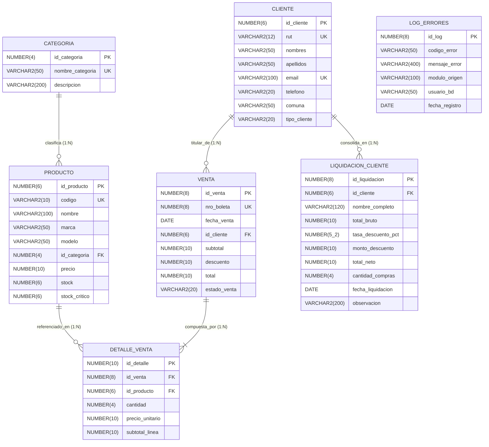
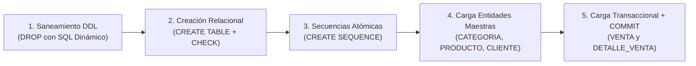
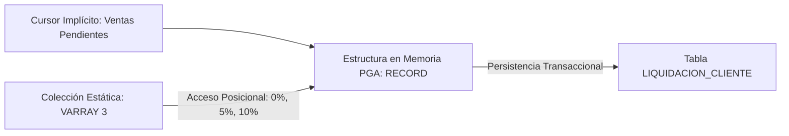
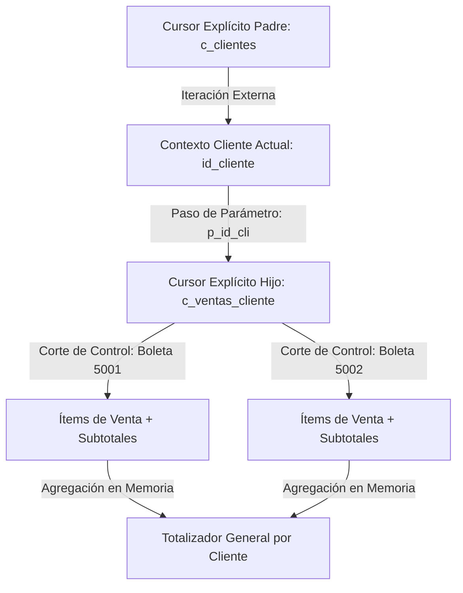
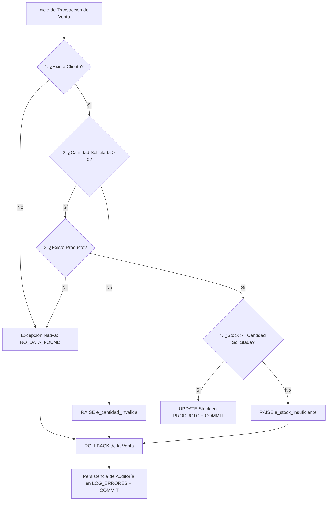

# Guía Técnica Paso a Paso: Arquitectura de Datos y Bloques PL/SQL
## Proyecto Sonido Vivo — Sistema Transaccional y de Liquidación Comercial

Este documento presenta un análisis técnico, estructurado y paso a paso de la arquitectura relacional y de los bloques de programación **PL/SQL** desarrollados para el caso **Sonido Vivo**.

El propósito de esta guía es explicar con claridad conceptual y precisión técnica cómo opera cada componente dentro del motor **Oracle Database**, articulando la lógica de negocio, las decisiones de diseño y el comportamiento línea por línea de cada script.

---

## Índice de Contenidos
0. [Arquitectura de Datos: Diagrama Entidad-Relación (MER)](#0-arquitectura-de-datos-diagrama-entidad-relación-mer)
1. [Bloque 1 (`01_esquema_y_datos.sql`): Definición del Esquema (DDL) y Poblamiento Transaccional (DML)](#bloque-1-01_esquema_y_datossql--definición-del-esquema-ddl-y-poblamiento-transaccional-dml)
2. [Bloque 2 (`02_bloque_record_varray.sql`): Estructuras Compuestas (`RECORD` y `VARRAY`) — Motor de Liquidación](#bloque-2-02_bloque_record_varraysql--estructuras-compuestas-record-y-varray--motor-de-liquidación)
3. [Bloque 3 (`03_bloque_cursores_anidados.sql`): Cursores Explícitos Parametrizados — Auditoría Jerárquica](#bloque-3-03_bloque_cursores_anidadossql--cursores-explícitos-parametrizados--auditoría-jerárquica)
4. [Bloque 4 (`04_bloque_excepciones.sql`): Gestión de Excepciones y Consistencia Transaccional ACID](#bloque-4-04_bloque_excepcionessql--gestión-de-excepciones-y-consistencia-transaccional-acid)
5. [Bloque 5 (`05_triggers_propuestos.sql`): Disparadores DML (`TRIGGER`) — Automatización de Inventario y Alertas](#bloque-5-05_triggers_propuestossql--disparadores-dml-trigger--automatización-de-inventario-y-alertas)
6. [Síntesis de Fundamentos Técnicos para Defensa Oral](#síntesis-de-fundamentos-técnicos-para-defensa-oral)

---

## 0. Arquitectura de Datos: Diagrama Entidad-Relación (MER)

Antes de abordar la capa procedural, es indispensable comprender la topología del modelo relacional que sustenta las operaciones de **Sonido Vivo**.

### 0.1 Diagrama Entidad-Relación



### 0.2 Análisis de Relaciones y Decisiones de Diseño

1. **`CATEGORIA` $\rightarrow$ `PRODUCTO` (Cardinalidad `1:N`):**
   - **Lógica Relacional:** Una familia de instrumentos agrupa múltiples productos del catálogo, mientras que cada producto se vincula unívocamente a una categoría mediante la clave foránea `id_categoria`.
2. **`CLIENTE` $\rightarrow$ `VENTA` (Cardinalidad `1:N`):**
   - **Lógica Relacional:** Un cliente puede registrar múltiples transacciones comerciales a lo largo del tiempo, pero cada documento tributario (`VENTA`) está asociado a un único titular (`id_cliente`).
3. **`VENTA` $\leftrightarrow$ `DETALLE_VENTA` $\leftrightarrow$ `PRODUCTO` (Patrón Maestro-Detalle / Entidad Asociativa):**
   - **Lógica Relacional:** Entre las órdenes de venta y los productos existe una relación conceptual de muchos a muchos (`N:M`), resuelta físicamente a través de la entidad débil `DETALLE_VENTA`.
   - `VENTA` actúa como la entidad **Maestro** (almacenando metadatos de la transacción e importes consolidados), mientras que `DETALLE_VENTA` opera como el **Detalle** (registrando cada ítem transado, su cantidad, el precio histórico de venta y el subtotal de línea).
4. **`CLIENTE` $\rightarrow$ `LIQUIDACION_CLIENTE` (Cardinalidad `1:N` con Patrón *Snapshot Histórico*):**
   - **Lógica Relacional:** Almacena el resultado del procesamiento batch de beneficios comerciales. Si bien mantiene integridad referencial hacia `CLIENTE` (`id_cliente`), incorpora deliberadamente el atributo `nombre_completo` bajo el patrón de **Snapshot Histórico (Cierre Contable)**. Esto garantiza la inmutabilidad nominal del respaldo financiero en la fecha de liquidación, aislándolo de eventuales actualizaciones posteriores en el maestro de clientes.
5. **`LOG_ERRORES` (Entidad de Auditoría Desacoplada):**
   - **Lógica Relacional:** Carece intencionalmente de restricciones de clave foránea (`FOREIGN KEY`). Su propósito es registrar tanto excepciones de negocio como búsquedas de identificadores inexistentes (`NO_DATA_FOUND`). Si dependiera referencialmente de `CLIENTE` o `PRODUCTO`, el motor impediría auditar intentos de compra sobre códigos o clientes inválidos.

---

## Bloque 1 (`01_esquema_y_datos.sql`) — Definición del Esquema (DDL) y Poblamiento Transaccional (DML)

### 1.1 Fundamento Conceptual y Estructura del Script
La construcción de la capa de persistencia requiere una secuencia de ejecución determinista que garantice la **idempotencia** (capacidad de ejecutar el script múltiples veces obteniendo siempre un estado limpio y consistente) y el respeto estricto de la **integridad referencial**. El script se estructura en cuatro fases:

1. **Saneamiento del Entorno mediante SQL Dinámico (`EXECUTE IMMEDIATE`):** Se eliminan las secuencias y tablas previas en orden inverso a su creación. El uso de bloques anónimos con captura de excepciones (`WHEN OTHERS THEN NULL`) evita que el script falle en su primera ejecución cuando los objetos aún no existen en el diccionario de datos.
2. **Definición Declarativa de Estructuras y Restricciones (`DDL`):** Se crean las 7 tablas incorporando reglas de validación directamente en el motor (`PRIMARY KEY`, `UNIQUE`, `FOREIGN KEY` y `CHECK`), asegurando que ninguna transacción pueda vulnerar las invariantes aritméticas o de dominio del negocio.
3. **Instanciación de Secuencias (`CREATE SEQUENCE`):** Se definen generadores numéricos independientes de las tablas (`SEQ_LOG_ERRORES` y `SEQ_LIQUIDACION_CLIENTE`), garantizando la asignación atómica y libre de bloqueos en escenarios concurrentes.
4. **Poblamiento Jerárquico de Datos Semilla (`DML`):** La inserción de registros sigue rigurosamente la topología Padre $\rightarrow$ Hijo: primero se pueblan los catálogos maestros (`CATEGORIA`, `PRODUCTO`, `CLIENTE`) y posteriormente las entidades transaccionales dependientes (`VENTA`, `DETALLE_VENTA`), finalizando con la confirmación explícita de la transacción (`COMMIT`).



---

### 1.2 Código del Bloque (`01_esquema_y_datos.sql`)

```sql
SET FEEDBACK ON;
SET DEFINE OFF;

-- ============================================================================
-- 1. LIMPIEZA DE OBJETOS PREVIOS (ORDEN POR DEPENDENCIAS)
-- ============================================================================
BEGIN
    EXECUTE IMMEDIATE 'DROP SEQUENCE SEQ_LOG_ERRORES';
EXCEPTION WHEN OTHERS THEN NULL; END;
/
BEGIN
    EXECUTE IMMEDIATE 'DROP SEQUENCE SEQ_LIQUIDACION_CLIENTE';
EXCEPTION WHEN OTHERS THEN NULL; END;
/
BEGIN
    EXECUTE IMMEDIATE 'DROP TABLE LOG_ERRORES CASCADE CONSTRAINTS';
EXCEPTION WHEN OTHERS THEN NULL; END;
/
BEGIN
    EXECUTE IMMEDIATE 'DROP TABLE LIQUIDACION_CLIENTE CASCADE CONSTRAINTS';
EXCEPTION WHEN OTHERS THEN NULL; END;
/
BEGIN
    EXECUTE IMMEDIATE 'DROP TABLE DETALLE_VENTA CASCADE CONSTRAINTS';
EXCEPTION WHEN OTHERS THEN NULL; END;
/
BEGIN
    EXECUTE IMMEDIATE 'DROP TABLE VENTA CASCADE CONSTRAINTS';
EXCEPTION WHEN OTHERS THEN NULL; END;
/
BEGIN
    EXECUTE IMMEDIATE 'DROP TABLE CLIENTE CASCADE CONSTRAINTS';
EXCEPTION WHEN OTHERS THEN NULL; END;
/
BEGIN
    EXECUTE IMMEDIATE 'DROP TABLE PRODUCTO CASCADE CONSTRAINTS';
EXCEPTION WHEN OTHERS THEN NULL; END;
/
BEGIN
    EXECUTE IMMEDIATE 'DROP TABLE CATEGORIA CASCADE CONSTRAINTS';
EXCEPTION WHEN OTHERS THEN NULL; END;
/

-- ============================================================================
-- 2. CREACIÓN DE TABLAS (DDL) Y SECUENCIAS
-- ============================================================================

-- Tabla 2.1: CATEGORIA
CREATE TABLE CATEGORIA (
    id_categoria     NUMBER(4)     NOT NULL,
    nombre_categoria VARCHAR2(50)  NOT NULL,
    descripcion      VARCHAR2(200),
    CONSTRAINT pk_categoria PRIMARY KEY (id_categoria),
    CONSTRAINT un_cat_nombre UNIQUE (nombre_categoria)
);

-- Tabla 2.2: PRODUCTO (Catálogo de Sonido Vivo)
CREATE TABLE PRODUCTO (
    id_producto   NUMBER(6)     NOT NULL,
    codigo        VARCHAR2(10)  NOT NULL,
    nombre        VARCHAR2(100) NOT NULL,
    marca         VARCHAR2(50)  NOT NULL,
    modelo        VARCHAR2(50),
    id_categoria  NUMBER(4)     NOT NULL,
    precio        NUMBER(10)    NOT NULL,
    stock         NUMBER(6)     NOT NULL,
    stock_critico NUMBER(6)     DEFAULT 3 NOT NULL,
    CONSTRAINT pk_producto PRIMARY KEY (id_producto),
    CONSTRAINT un_prod_codigo UNIQUE (codigo),
    CONSTRAINT fk_prod_cat FOREIGN KEY (id_categoria) REFERENCES CATEGORIA (id_categoria),
    CONSTRAINT chk_prod_precio CHECK (precio > 0),
    CONSTRAINT chk_prod_stock CHECK (stock >= 0),
    CONSTRAINT chk_prod_stock_critico CHECK (stock_critico >= 0)
);

-- Tabla 2.3: CLIENTE
CREATE TABLE CLIENTE (
    id_cliente   NUMBER(6)     NOT NULL,
    rut          VARCHAR2(12)  NOT NULL,
    nombres      VARCHAR2(50)  NOT NULL,
    apellidos    VARCHAR2(50)  NOT NULL,
    email        VARCHAR2(100) NOT NULL,
    telefono     VARCHAR2(20),
    comuna       VARCHAR2(50)  DEFAULT 'Viña del Mar' NOT NULL,
    tipo_cliente VARCHAR2(20)  DEFAULT 'ESTANDAR' NOT NULL,
    CONSTRAINT pk_cliente PRIMARY KEY (id_cliente),
    CONSTRAINT un_cli_rut UNIQUE (rut),
    CONSTRAINT un_cli_email UNIQUE (email),
    CONSTRAINT chk_cli_tipo CHECK (tipo_cliente IN ('ESTANDAR', 'FRECUENTE', 'PREMIUM'))
);

-- Tabla 2.4: VENTA (Cabecera de transacciones comerciales)
CREATE TABLE VENTA (
    id_venta     NUMBER(8)    NOT NULL,
    nro_boleta   NUMBER(8)    NOT NULL,
    fecha_venta  DATE         DEFAULT SYSDATE NOT NULL,
    id_cliente   NUMBER(6)    NOT NULL,
    subtotal     NUMBER(10)   DEFAULT 0 NOT NULL,
    descuento    NUMBER(10)   DEFAULT 0 NOT NULL,
    total        NUMBER(10)   DEFAULT 0 NOT NULL,
    estado_venta VARCHAR2(20) DEFAULT 'PENDIENTE' NOT NULL,
    CONSTRAINT pk_venta PRIMARY KEY (id_venta),
    CONSTRAINT un_venta_boleta UNIQUE (nro_boleta),
    CONSTRAINT fk_venta_cliente FOREIGN KEY (id_cliente) REFERENCES CLIENTE (id_cliente),
    CONSTRAINT chk_venta_totales CHECK (subtotal >= 0 AND descuento >= 0 AND total = (subtotal - descuento)),
    CONSTRAINT chk_venta_estado CHECK (estado_venta IN ('PENDIENTE', 'LIQUIDADA', 'ANULADA'))
);

-- Tabla 2.5: DETALLE_VENTA (Líneas de productos por cada orden)
CREATE TABLE DETALLE_VENTA (
    id_detalle      NUMBER(10) NOT NULL,
    id_venta        NUMBER(8)  NOT NULL,
    id_producto     NUMBER(6)  NOT NULL,
    cantidad        NUMBER(4)  NOT NULL,
    precio_unitario NUMBER(10) NOT NULL,
    subtotal_linea  NUMBER(10) NOT NULL,
    CONSTRAINT pk_detalle_venta PRIMARY KEY (id_detalle),
    CONSTRAINT fk_det_venta FOREIGN KEY (id_venta) REFERENCES VENTA (id_venta),
    CONSTRAINT fk_det_prod FOREIGN KEY (id_producto) REFERENCES PRODUCTO (id_producto),
    CONSTRAINT chk_det_cant CHECK (cantidad > 0),
    CONSTRAINT chk_det_precio CHECK (precio_unitario > 0),
    CONSTRAINT chk_det_subtotal CHECK (subtotal_linea = cantidad * precio_unitario)
);

-- Tabla 2.6: LIQUIDACION_CLIENTE (Snapshot Histórico de liquidaciones)
CREATE TABLE LIQUIDACION_CLIENTE (
    id_liquidacion      NUMBER(8)     NOT NULL,
    id_cliente          NUMBER(6)     NOT NULL,
    nombre_completo     VARCHAR2(120) NOT NULL,
    total_bruto         NUMBER(10)    NOT NULL,
    tasa_descuento_pct  NUMBER(5,2)   NOT NULL,
    monto_descuento     NUMBER(10)    NOT NULL,
    total_neto          NUMBER(10)    NOT NULL,
    cantidad_compras    NUMBER(4)     NOT NULL,
    fecha_liquidacion   DATE          DEFAULT SYSDATE NOT NULL,
    observacion         VARCHAR2(200),
    CONSTRAINT pk_liq_cliente PRIMARY KEY (id_liquidacion),
    CONSTRAINT fk_liq_cli FOREIGN KEY (id_cliente) REFERENCES CLIENTE (id_cliente)
);

-- Tabla 2.7: LOG_ERRORES (Auditoría centralizada)
CREATE TABLE LOG_ERRORES (
    id_log         NUMBER(8)      NOT NULL,
    codigo_error   VARCHAR2(50)   NOT NULL,
    mensaje_error  VARCHAR2(400)  NOT NULL,
    modulo_origen  VARCHAR2(100)  NOT NULL,
    usuario_bd     VARCHAR2(50)   DEFAULT USER NOT NULL,
    fecha_registro DATE           DEFAULT SYSDATE NOT NULL,
    CONSTRAINT pk_log_errores PRIMARY KEY (id_log)
);

-- 2.8 SECUENCIAS
CREATE SEQUENCE SEQ_LOG_ERRORES START WITH 1 INCREMENT BY 1 NOCACHE NOCYCLE;
CREATE SEQUENCE SEQ_LIQUIDACION_CLIENTE START WITH 1 INCREMENT BY 1 NOCACHE NOCYCLE;

-- ============================================================================
-- 3. CARGA INICIAL DE DATOS (DML - INSERT INTO)
-- ============================================================================

-- 3.1 Categorías
INSERT INTO CATEGORIA (id_categoria, nombre_categoria, descripcion) VALUES (1, 'Guitarras Acústicas', 'Guitarras folk, clásicas y electroacústicas');
INSERT INTO CATEGORIA (id_categoria, nombre_categoria, descripcion) VALUES (2, 'Guitarras Eléctricas', 'Modelos Stratocaster, Telecaster y Les Paul');
INSERT INTO CATEGORIA (id_categoria, nombre_categoria, descripcion) VALUES (3, 'Bajos Eléctricos', 'Bajos activos y pasivos de 4 y 5 cuerdas');
INSERT INTO CATEGORIA (id_categoria, nombre_categoria, descripcion) VALUES (4, 'Teclados y Pianos', 'Pianos digitales y sintetizadores');
INSERT INTO CATEGORIA (id_categoria, nombre_categoria, descripcion) VALUES (5, 'Audio Profesional', 'Micrófonos, monitores e interfaces');
INSERT INTO CATEGORIA (id_categoria, nombre_categoria, descripcion) VALUES (6, 'Accesorios', 'Cuerdas, baquetas, fundas y cables');

-- 3.2 Productos
INSERT INTO PRODUCTO VALUES (101, 'GA001', 'Guitarra Acústica Folk F310', 'Yamaha', 'F310', 1, 129990, 8, 3);
INSERT INTO PRODUCTO VALUES (102, 'GA002', 'Guitarra Acústica Dreadnought CD-60S', 'Fender', 'CD-60S', 1, 189990, 5, 3);
INSERT INTO PRODUCTO VALUES (103, 'GE001', 'Guitarra Eléctrica Player Stratocaster', 'Fender', 'Player HSS', 2, 749990, 4, 2);
INSERT INTO PRODUCTO VALUES (104, 'GE002', 'Guitarra Eléctrica Les Paul Tribute', 'Gibson', 'Tribute Satin', 2, 1199990, 2, 1);
INSERT INTO PRODUCTO VALUES (105, 'BA001', 'Bajo Eléctrico Player Precision Bass', 'Fender', 'P-Bass 4C', 3, 799990, 3, 2);
INSERT INTO PRODUCTO VALUES (106, 'TE001', 'Piano Digital P-45B 88 Teclas', 'Yamaha', 'P-45B', 4, 459990, 6, 2);
INSERT INTO PRODUCTO VALUES (107, 'AP001', 'Micrófono Dinámico Vocal SM58', 'Shure', 'SM58-LC', 5, 114990, 12, 4);
INSERT INTO PRODUCTO VALUES (108, 'AP002', 'Interfaz de Audio Scarlett 2i2 4th Gen', 'Focusrite', '2i2 Gen4', 5, 199990, 7, 3);
INSERT INTO PRODUCTO VALUES (109, 'AC001', 'Cuerdas Guitarra Eléctrica 010-046', 'Ernie Ball', 'Regular Slinky', 6, 8990, 35, 10);
INSERT INTO PRODUCTO VALUES (110, 'AC002', 'Baquetas American Classic 5A Madera', 'Vic Firth', '5A', 6, 12990, 20, 5);

-- 3.3 Clientes
INSERT INTO CLIENTE VALUES (1, '15.482.913-4', 'Carlos', 'Valenzuela Pinto', 'carlos.valenzuela@gmail.com', '+56981234567', 'Viña del Mar', 'PREMIUM');
INSERT INTO CLIENTE VALUES (2, '18.324.571-K', 'Valentina', 'Morales Soto', 'vale.morales@outlook.com', '+56972345678', 'Valparaíso', 'FRECUENTE');
INSERT INTO CLIENTE VALUES (3, '19.874.120-2', 'Matías', 'Lagos Herrera', 'matias.lagos@gmail.com', '+56963456789', 'Concón', 'ESTANDAR');
INSERT INTO CLIENTE VALUES (4, '14.102.345-8', 'Camila', 'Rojas Benítez', 'camila.rojas@vtr.net', '+56954567890', 'Quilpué', 'PREMIUM');
INSERT INTO CLIENTE VALUES (5, '20.145.892-1', 'Ignacio', 'Garrido Ruiz', 'ignacio.garrido@gmail.com', '+56945678901', 'Viña del Mar', 'ESTANDAR');

-- 3.4 Ventas y Detalles de Venta
-- Venta 1001 y 1002 (Cliente 1: Carlos Valenzuela -> Acumula $891.950 -> Tramo Oro 10% + 2% Premium = 12%)
INSERT INTO VENTA VALUES (1001, 5001, TO_DATE('01/09/2026', 'DD/MM/YYYY'), 1, 864980, 0, 864980, 'PENDIENTE');
INSERT INTO DETALLE_VENTA VALUES (1, 1001, 103, 1, 749990, 749990);
INSERT INTO DETALLE_VENTA VALUES (2, 1001, 107, 1, 114990, 114990);

INSERT INTO VENTA VALUES (1002, 5002, TO_DATE('05/09/2026', 'DD/MM/YYYY'), 1, 26970, 0, 26970, 'PENDIENTE');
INSERT INTO DETALLE_VENTA VALUES (3, 1002, 109, 3, 8990, 26970);

-- Venta 1003 (Cliente 2: Valentina Morales -> Acumula $459.990 -> Tramo Plata 5%)
INSERT INTO VENTA VALUES (1003, 5003, TO_DATE('03/09/2026', 'DD/MM/YYYY'), 2, 459990, 0, 459990, 'PENDIENTE');
INSERT INTO DETALLE_VENTA VALUES (4, 1003, 106, 1, 459990, 459990);

-- Venta 1004 (Cliente 3: Matías Lagos -> Acumula $155.970 -> Tramo Inicial 0%)
INSERT INTO VENTA VALUES (1004, 5004, TO_DATE('06/09/2026', 'DD/MM/YYYY'), 3, 155970, 0, 155970, 'PENDIENTE');
INSERT INTO DETALLE_VENTA VALUES (5, 1004, 101, 1, 129990, 129990);
INSERT INTO DETALLE_VENTA VALUES (6, 1004, 110, 2, 12990, 25980);

-- Venta 1005 (Cliente 4: Camila Rojas -> Acumula $999.980 -> Tramo Oro 10% + 2% Premium = 12%)
INSERT INTO VENTA VALUES (1005, 5005, TO_DATE('08/09/2026', 'DD/MM/YYYY'), 4, 999980, 0, 999980, 'PENDIENTE');
INSERT INTO DETALLE_VENTA VALUES (7, 1005, 105, 1, 799990, 799990);
INSERT INTO DETALLE_VENTA VALUES (8, 1005, 108, 1, 199990, 199990);

COMMIT;
```

---

### 1.3 Desglose Técnico Línea por Línea (`01_esquema_y_datos.sql`)

| Líneas | Instrucción / Código | Propósito Técnico y Justificación de Diseño |
| :--- | :--- | :--- |
| **9-10** | `SET FEEDBACK ON; SET DEFINE OFF;` | Directivas de entorno del cliente SQL. `SET FEEDBACK ON` habilita la confirmación del conteo de filas afectadas por cada sentencia. `SET DEFINE OFF` desactiva el escaneo de variables de sustitución (`&`), evitando interrupciones interactivas durante la inserción de cadenas de texto. |
| **15-50** | `BEGIN EXECUTE IMMEDIATE 'DROP ...'; EXCEPTION WHEN OTHERS THEN NULL; END;` | **Saneamiento Idempotente:** En Oracle no existe la sintaxis nativa `DROP TABLE IF EXISTS` en versiones previas a 23ai. Al encapsular la sentencia DDL dentro de un bloque PL/SQL con `EXECUTE IMMEDIATE` y silenciar el error (`ORA-00942: table or view does not exist`), el script puede re-ejecutarse sin interrupciones. La cláusula `CASCADE CONSTRAINTS` elimina simultáneamente las restricciones de integridad referencial dependientes. |
| **57-63** | `CREATE TABLE CATEGORIA (...)` | Define la entidad maestra de clasificación. Implementa `PRIMARY KEY (id_categoria)` para unicidad de registro y una restricción candidata `UNIQUE (nombre_categoria)` para evitar duplicidad semántica en el catálogo. |
| **66-82** | `CREATE TABLE PRODUCTO (...)` | Define el inventario físico. Incorpora integridad referencial (`fk_prod_cat`), un umbral preventivo por defecto (`DEFAULT 3` en `stock_critico`) y restricciones de dominio `CHECK` que impiden precios nulos/negativos (`precio > 0`) o saldos de inventario inválidos (`stock >= 0`). |
| **85-98** | `CREATE TABLE CLIENTE (...)` | Entidad maestra de clientes. Garantiza la unicidad de identificadores tributarios y de contacto (`UNIQUE` en `rut` y `email`) y acota el dominio de segmentación comercial mediante `CHECK (tipo_cliente IN ('ESTANDAR', 'FRECUENTE', 'PREMIUM'))`. |
| **101-115** | `CREATE TABLE VENTA (...)` | Cabecera transaccional. Destaca la restricción compuesta `chk_venta_totales`, la cual valida a nivel de motor que `total = (subtotal - descuento)`, garantizando consistencia aritmética declarativa antes de persistir en disco. |
| **118-131** | `CREATE TABLE DETALLE_VENTA (...)` | Entidad asociativa que vincula `VENTA` y `PRODUCTO` mediante doble clave foránea. La restricción `chk_det_subtotal` exige que `subtotal_linea = cantidad * precio_unitario`, impidiendo discrepancias de cálculo por línea. |
| **138-151** | `CREATE TABLE LIQUIDACION_CLIENTE (...)` | Tabla de destino para el procesamiento por lotes. Preserva el atributo `nombre_completo` bajo el patrón **Snapshot Histórico**, inmovilizando la identificación legal del cliente al momento de la liquidación contable. |
| **154-162** | `CREATE TABLE LOG_ERRORES (...)` | Repositorio centralizado de auditoría. Asigna valores por defecto mediante pseudo-funciones del sistema: `DEFAULT USER` (esquema ejecutor) y `DEFAULT SYSDATE` (marca temporal exacta de la excepción). |
| **167-168** | `CREATE SEQUENCE SEQ_... START WITH 1 INCREMENT BY 1 NOCACHE NOCYCLE;` | Creación de secuencias atómicas. Reemplaza el antipatrón `SELECT MAX(id) + 1` (vulnerable a condiciones de carrera en accesos simultáneos). `NOCACHE` asegura una numeración contigua sin saltos en memoria y `NOCYCLE` impide que el contador se reinicie. |
| **175-180** | `INSERT INTO CATEGORIA ...` | Poblamiento inicial de las 6 categorías maestras (IDs `1` al `6`). Debe ejecutarse en primer lugar dado que actúa como entidad padre de `PRODUCTO`. |
| **183-211** | `INSERT INTO PRODUCTO ...` | Carga de los 10 productos del catálogo (IDs `101` al `110`). **Diseño de casos de prueba:** El producto `104` (`GE002`, Gibson Les Paul Tribute) se parametriza con `stock = 2` y `stock_critico = 1`, preparando el escenario para evaluar la excepción de quiebre de stock en el Bloque 4. |
| **214-227** | `INSERT INTO CLIENTE ...` | Inserción de 5 clientes segmentados por categoría y ubicación geográfica. **Diseño de casos de prueba:** El cliente `5` (*Ignacio Garrido*) se registra deliberadamente sin transacciones asociadas para verificar el filtrado excluyente de los cursores en los Bloques 2 y 3. |
| **231-272** | `INSERT INTO VENTA ...` e `INSERT INTO DETALLE_VENTA ...` | Registro de 5 órdenes en estado `'PENDIENTE'` junto a sus 8 líneas de detalle. Se emplea la función explícita `TO_DATE('...', 'DD/MM/YYYY')` para independizar la carga del parámetro regional `NLS_DATE_FORMAT` de la sesión. Los montos acumulados fueron calibrados para ejercitar los tres tramos del `VARRAY` (`< $200.000`, `$200.000 - $700.000` y `> $700.000`). |
| **274** | `COMMIT;` | Confirmación explícita de las sentencias DML, haciendo que los datos insertados sean permanentes y visibles para el resto de las sesiones y bloques subsecuentes. |
| **277-284** | `PROMPT ... SELECT COUNT(*) ...` | Consultas de verificación post-carga que validan la cardinalidad inicial de cada tabla en la salida estándar. |

---

## Bloque 2 (`02_bloque_record_varray.sql`) — Estructuras Compuestas (`RECORD` y `VARRAY`) — Motor de Liquidación

### 2.1 Fundamento Conceptual y Arquitectura en Memoria
En el procesamiento de cierres comerciales por lotes (*batch processing*), operar con múltiples variables escalares independientes degrada la legibilidad y mantenibilidad del código. Este bloque resuelve el problema combinando dos estructuras compuestas en la memoria privada del proceso (**PGA**):

- **Tipo Compuesto `RECORD` (`t_rec_liquidacion`):** Actúa como un contenedor lógico en memoria que encapsula atributos heterogéneos (`NUMBER`, `VARCHAR2`, y tipos anclados mediante `%TYPE`) pertenecientes a una misma unidad de negocio: la liquidación de un cliente. Permite manipular todos los datos calculados bajo una única instancia estructurada (`v_liquidacion`).
- **Colección `VARRAY` (`t_arr_tasas`):** Representa un arreglo unidimensional de tamaño estático y acotado (3 posiciones) que almacena en memoria la escala paramétrica de descuentos comerciales:
  - Índice `(1)`: `0.00%` (Tramo Inicial: compras acumuladas $< \$200.000$)
  - Índice `(2)`: `5.00%` (Tramo Plata: compras entre $\$200.000$ y $\$700.000$)
  - Índice `(3)`: `10.00%` (Tramo Oro: compras superiores a $\$700.000$)
  Al residir en memoria, la evaluación de tramos se ejecuta con acceso posicional directo $O(1)$, evitando consultas repetitivas a tablas secundarias de disco.



---

### 2.2 Código del Bloque (`02_bloque_record_varray.sql`)

```sql
SET SERVEROUTPUT ON SIZE UNLIMITED;

DECLARE
    -- 1. Definición del tipo compuesto RECORD
    TYPE t_rec_liquidacion IS RECORD (
        id_cliente          CLIENTE.id_cliente%TYPE,
        nombre_completo     VARCHAR2(120),
        tipo_cliente        CLIENTE.tipo_cliente%TYPE,
        total_bruto         NUMBER(10),
        tasa_descuento_pct  NUMBER(5,2),
        monto_descuento     NUMBER(10),
        total_neto          NUMBER(10),
        cantidad_ordenes    NUMBER(4),
        observacion         VARCHAR2(200)
    );

    -- 2. Definición de la colección VARRAY de dimensión fija (3 tramos)
    TYPE t_arr_tasas IS VARRAY(3) OF NUMBER(5,2);

    -- 3. Instanciación de variables de trabajo
    v_liquidacion       t_rec_liquidacion;
    v_escalas_descuento t_arr_tasas := t_arr_tasas(0.00, 5.00, 10.00);
    v_contador_liq      NUMBER(8) := 0;

BEGIN
    DBMS_OUTPUT.PUT_LINE('================================================================================');
    DBMS_OUTPUT.PUT_LINE('           SONIDO VIVO — MOTOR DE LIQUIDACIÓN DE CLIENTES (RECORD + VARRAY)     ');
    DBMS_OUTPUT.PUT_LINE('================================================================================');

    -- Saneamiento previo de la tabla de destino
    DELETE FROM LIQUIDACION_CLIENTE;

    -- Iteración sobre clientes con órdenes en estado PENDIENTE mediante cursor FOR implícito
    FOR reg_cli IN (
        SELECT c.id_cliente,
               c.nombres || ' ' || c.apellidos AS nombre_completo,
               c.tipo_cliente,
               COUNT(v.id_venta) AS cant_compras,
               NVL(SUM(v.total), 0) AS monto_acumulado
        FROM CLIENTE c
        JOIN VENTA v ON c.id_cliente = v.id_cliente
        WHERE v.estado_venta = 'PENDIENTE'
        GROUP BY c.id_cliente, c.nombres, c.apellidos, c.tipo_cliente
        ORDER BY c.id_cliente
    ) LOOP

        -- Paso A: Poblamiento de atributos base en la instancia RECORD
        v_liquidacion.id_cliente       := reg_cli.id_cliente;
        v_liquidacion.nombre_completo  := reg_cli.nombre_completo;
        v_liquidacion.tipo_cliente     := reg_cli.tipo_cliente;
        v_liquidacion.total_bruto      := reg_cli.monto_acumulado;
        v_liquidacion.cantidad_ordenes := reg_cli.cant_compras;

        -- Paso B: Determinación de tasa mediante indexación sobre el VARRAY
        IF v_liquidacion.total_bruto < 200000 THEN
            v_liquidacion.tasa_descuento_pct := v_escalas_descuento(1); -- 0%
            v_liquidacion.observacion        := 'Tramo Inicial: Sin descuento adicional por volumen';
        ELSIF v_liquidacion.total_bruto BETWEEN 200000 AND 700000 THEN
            v_liquidacion.tasa_descuento_pct := v_escalas_descuento(2); -- 5%
            v_liquidacion.observacion        := 'Tramo Plata: 5% descuento por volumen de compra';
        ELSE
            v_liquidacion.tasa_descuento_pct := v_escalas_descuento(3); -- 10%
            v_liquidacion.observacion        := 'Tramo Oro: 10% beneficio preferencial por gran volumen';
        END IF;

        -- Paso C: Regla de negocio adicional por fidelización PREMIUM (+2%)
        IF v_liquidacion.tipo_cliente = 'PREMIUM' THEN
            v_liquidacion.tasa_descuento_pct := v_liquidacion.tasa_descuento_pct + 2.00;
            v_liquidacion.observacion        := v_liquidacion.observacion || ' (+2% fidelidad PREMIUM)';
        END IF;

        -- Paso D: Cálculo aritmético de importes en memoria
        v_liquidacion.monto_descuento := ROUND(v_liquidacion.total_bruto * (v_liquidacion.tasa_descuento_pct / 100));
        v_liquidacion.total_neto      := v_liquidacion.total_bruto - v_liquidacion.monto_descuento;

        -- Paso E: Persistencia en tabla física de control contable
        INSERT INTO LIQUIDACION_CLIENTE (
            id_liquidacion,
            id_cliente,
            nombre_completo,
            total_bruto,
            tasa_descuento_pct,
            monto_descuento,
            total_neto,
            cantidad_compras,
            fecha_liquidacion,
            observacion
        ) VALUES (
            SEQ_LIQUIDACION_CLIENTE.NEXTVAL,
            v_liquidacion.id_cliente,
            v_liquidacion.nombre_completo,
            v_liquidacion.total_bruto,
            v_liquidacion.tasa_descuento_pct,
            v_liquidacion.monto_descuento,
            v_liquidacion.total_neto,
            v_liquidacion.cantidad_ordenes,
            SYSDATE,
            v_liquidacion.observacion
        );

        -- Paso F: Trazabilidad en salida estándar
        DBMS_OUTPUT.PUT_LINE('Cliente: ' || RPAD(v_liquidacion.nombre_completo, 30) ||
                             ' | Bruto: $' || LPAD(TO_CHAR(v_liquidacion.total_bruto, '999G999G999'), 12) ||
                             ' | Tasa: ' || LPAD(TO_CHAR(v_liquidacion.tasa_descuento_pct, '90.00'), 6) || '%' ||
                             ' | Neto: $' || LPAD(TO_CHAR(v_liquidacion.total_neto, '999G999G999'), 12));

        v_contador_liq := v_contador_liq + 1;

    END LOOP;

    -- Confirmación transaccional
    COMMIT;
    DBMS_OUTPUT.PUT_LINE('--------------------------------------------------------------------------------');
    DBMS_OUTPUT.PUT_LINE('>> PROCESO FINALIZADO: ' || v_contador_liq || ' liquidaciones calculadas y guardadas.');
    DBMS_OUTPUT.PUT_LINE('================================================================================');

END;
/
```

---

### 2.3 Desglose Técnico Línea por Línea (`02_bloque_record_varray.sql`)

| Líneas | Instrucción / Código | Propósito Técnico y Justificación de Diseño |
| :--- | :--- | :--- |
| **8** | `SET SERVEROUTPUT ON SIZE UNLIMITED;` | Habilita el búfer de salida del paquete `DBMS_OUTPUT` sin restricción de tamaño, permitiendo visualizar la traza de ejecución en consola. |
| **10** | `DECLARE` | Inicia la sección declarativa del bloque anónimo PL/SQL, donde se definen tipos de datos locales e instancias en memoria. |
| **16-26** | `TYPE t_rec_liquidacion IS RECORD (...)` | Define la estructura compuesta `RECORD`. Combina atributos escalares con referencias dinámicas `%TYPE` (`CLIENTE.id_cliente%TYPE`, `CLIENTE.tipo_cliente%TYPE`), logrando desacoplamiento frente a eventuales modificaciones de longitud o precisión en el esquema subyacente. |
| **32** | `TYPE t_arr_tasas IS VARRAY(3) OF NUMBER(5,2);` | Declara el tipo de colección `VARRAY` con cota superior de 3 elementos numéricos de precisión decimal. Es la estructura óptima cuando el conjunto de parámetros es estático, ordenado y de cardinalidad conocida. |
| **37** | `v_liquidacion t_rec_liquidacion;` | Instancia en memoria una variable basada en el tipo `t_rec_liquidacion` que actuará como área de trabajo por cada iteración del bucle. |
| **38** | `v_escalas_descuento t_arr_tasas := t_arr_tasas(0.00, 5.00, 10.00);` | Invoca el **constructor del tipo `VARRAY`** para inicializar en línea las tres tasas porcentuales en memoria (`0%`, `5%` y `10%`). |
| **39** | `v_contador_liq NUMBER(8) := 0;` | Variable acumuladora inicializada en cero para contabilizar el volumen total de registros procesados. |
| **41** | `BEGIN` | Da inicio al cuerpo ejecutable del bloque procedural. |
| **47** | `DELETE FROM LIQUIDACION_CLIENTE;` | Vacía los registros previos de la tabla de destino dentro de la transacción activa, garantizando que las ejecuciones sucesivas del bloque sean idempotentes. |
| **50-60** | `FOR reg_cli IN (SELECT ... WHERE estado_venta = 'PENDIENTE' ...) LOOP` | Implementa un cursor implícito mediante un bucle `FOR`. Ejecuta una consulta agregada (`COUNT` y `SUM` protegida con `NVL`) sobre las ventas pendientes agrupadas por cliente. El motor gestiona de forma autónoma la apertura, lectura (`FETCH`) y liberación de memoria del cursor. |
| **64-68** | `v_liquidacion.id_cliente := reg_cli.id_cliente; ...` | Transfiere los valores desde el registro implícito del cursor (`reg_cli`) hacia los atributos internos de la estructura `v_liquidacion` empleando notación de punto (`registro.atributo`). |
| **71-80** | `IF ... THEN v_escalas_descuento(1) ... ELSIF ...` | Estructura condicional que clasifica el monto bruto acumulado y extrae la tasa de descuento accediendo por subíndice (`1`, `2` o `3`) a la colección `VARRAY` (en PL/SQL los subíndices son base 1). |
| **83-86** | `IF v_liquidacion.tipo_cliente = 'PREMIUM' THEN ... + 2.00;` | Regla de negocio acumulativa: otorga una bonificación adicional de 2 puntos porcentuales a los clientes de categoría `'PREMIUM'` y concatena la glosa justificativa en el atributo `observacion`. |
| **89-90** | `v_liquidacion.monto_descuento := ROUND(...)` | Ejecuta el cálculo financiero en memoria aplicando redondeo entero (`ROUND`) compatible con pesos chilenos (CLP), determinando el importe de descuento y el saldo neto a pagar. |
| **93-115** | `INSERT INTO LIQUIDACION_CLIENTE (...) VALUES (SEQ_LIQUIDACION_CLIENTE.NEXTVAL, ...)` | Persiste los atributos del `RECORD` en la tabla relacional, invocando el método `.NEXTVAL` de la secuencia para asignar una clave primaria única. |
| **118-121** | `DBMS_OUTPUT.PUT_LINE(...)` | Genera el reporte tabular en consola utilizando funciones de alineación de cadenas (`RPAD`, `LPAD`) y máscaras de formato numérico (`TO_CHAR(..., '999G999G999')`). |
| **125** | `END LOOP;` | Finaliza el ciclo actual del cursor e itera hacia el siguiente cliente. |
| **127** | `COMMIT;` | Confirma la transacción completa (tanto el `DELETE` inicial como todos los `INSERT` generados), asegurando la propiedad de **Durabilidad** del estándar ACID. |
| **132** | `END; /` | Cierra el bloque anónimo y envía el delimitador `/` para su compilación y ejecución inmediata en el motor. |

---

## Bloque 3 (`03_bloque_cursores_anidados.sql`) — Cursores Explícitos Parametrizados — Auditoría Jerárquica

### 3.1 Fundamento Conceptual y Sincronización Maestro-Detalle
Cuando se requiere generar reportes de auditoría que conserven simultáneamente la información de cabecera (nivel Maestro) y el desglose pormenorizado de transacciones (nivel Detalle), una consulta plana mediante `GROUP BY` resulta insuficiente porque colapsa las filas individuales. Por el contrario, un único `JOIN` plano repite innecesariamente los datos del cliente en cada línea de producto.

La solución arquitectónica en PL/SQL consiste en implementar **cursores explícitos anidados con paso de parámetros**:
- **Cursor Padre (`c_clientes`):** Recorre el conjunto de clientes activos. Incorpora un predicado existencial (`WHERE EXISTS`) para descartar en el optimizador SQL a aquellos clientes que no registran compras, reduciendo el costo de procesamiento en memoria.
- **Cursor Hijo Parametrizado (`c_ventas_cliente(p_id_cli)`):** Define formalmente un parámetro de entrada (`p_id_cli`) anclado al tipo del identificador del cliente. En cada iteración del bucle externo, el cursor hijo se abre filtrando exactamente las órdenes y líneas de productos pertenecientes al cliente en curso, aplicando además una técnica de **corte de control** para agrupar visualmente los ítems por número de boleta.



---

### 3.2 Código del Bloque (`03_bloque_cursores_anidados.sql`)

```sql
SET SERVEROUTPUT ON SIZE UNLIMITED;

DECLARE
    -- 1. Cursor Explícito Padre: Clientes con actividad transaccional verificada
    CURSOR c_clientes IS
        SELECT c.id_cliente,
               c.rut,
               c.nombres || ' ' || c.apellidos AS cliente_nombre,
               c.comuna,
               c.tipo_cliente
        FROM CLIENTE c
        WHERE EXISTS (
            SELECT 1 
            FROM VENTA v 
            WHERE v.id_cliente = c.id_cliente
        )
        ORDER BY c.id_cliente;

    -- 2. Cursor Explícito Hijo Parametrizado: Cruce relacional de 4 entidades
    CURSOR c_ventas_cliente (p_id_cli CLIENTE.id_cliente%TYPE) IS
        SELECT v.nro_boleta,
               v.fecha_venta,
               p.codigo AS codigo_prod,
               p.nombre AS nombre_prod,
               cat.nombre_categoria,
               d.cantidad,
               d.precio_unitario,
               d.subtotal_linea
        FROM VENTA v
        JOIN DETALLE_VENTA d ON v.id_venta = d.id_venta
        JOIN PRODUCTO p      ON d.id_producto = p.id_producto
        JOIN CATEGORIA cat   ON p.id_categoria = cat.id_categoria
        WHERE v.id_cliente = p_id_cli
        ORDER BY v.nro_boleta, d.id_detalle;

    -- 3. Variables de control de flujo y acumuladores aritméticos
    v_total_cliente       NUMBER(10);
    v_total_unidades      NUMBER(6);
    v_boleta_actual       NUMBER(8);
    v_contador_clientes   NUMBER(4) := 0;

BEGIN
    DBMS_OUTPUT.PUT_LINE('================================================================================');
    DBMS_OUTPUT.PUT_LINE('     SONIDO VIVO — AUDITORÍA DETALLADA DE COMPRAS POR CLIENTE (CURSORES)        ');
    DBMS_OUTPUT.PUT_LINE('================================================================================');

    -- BUCLE EXTERNO (Nivel Maestro): Itera sobre cada registro del cursor padre
    FOR reg_cli IN c_clientes LOOP
        v_contador_clientes := v_contador_clientes + 1;
        v_total_cliente     := 0;
        v_total_unidades    := 0;
        v_boleta_actual     := 0;

        -- Impresión de cabecera del cliente
        DBMS_OUTPUT.PUT_LINE('--------------------------------------------------------------------------------');
        DBMS_OUTPUT.PUT_LINE('CLIENTE [' || reg_cli.id_cliente || '] ' || UPPER(reg_cli.cliente_nombre) || 
                             ' | RUT: ' || reg_cli.rut || 
                             ' | Comuna: ' || reg_cli.comuna || 
                             ' | Categoría: ' || reg_cli.tipo_cliente);
        DBMS_OUTPUT.PUT_LINE('--------------------------------------------------------------------------------');

        -- BUCLE INTERNO (Nivel Detalle): Invoca al cursor hijo inyectando el ID del cliente actual
        FOR reg_det IN c_ventas_cliente(reg_cli.id_cliente) LOOP
            
            -- Lógica de Corte de Control por cambio de documento (Boleta)
            IF v_boleta_actual <> reg_det.nro_boleta THEN
                v_boleta_actual := reg_det.nro_boleta;
                DBMS_OUTPUT.PUT_LINE('  >> Boleta N° ' || v_boleta_actual || ' (Emitida: ' || TO_CHAR(reg_det.fecha_venta, 'DD/MM/YYYY') || '):');
            END IF;

            -- Desglose de línea de producto
            DBMS_OUTPUT.PUT_LINE('     * [' || reg_det.codigo_prod || '] ' || 
                                 RPAD(reg_det.nombre_prod, 32) || 
                                 ' (' || RPAD(reg_det.nombre_categoria, 18) || ') ' ||
                                 ' | Cant: ' || LPAD(reg_det.cantidad, 2) || 
                                 ' x $' || LPAD(TO_CHAR(reg_det.precio_unitario, '999G999'), 9) || 
                                 ' = $' || LPAD(TO_CHAR(reg_det.subtotal_linea, '999G999'), 9));

            -- Incremento de acumuladores por cliente
            v_total_cliente  := v_total_cliente + reg_det.subtotal_linea;
            v_total_unidades := v_total_unidades + reg_det.cantidad;

        END LOOP; -- Cierre implícito del cursor hijo

        -- Impresión del totalizador consolidado por cliente
        DBMS_OUTPUT.PUT_LINE('  --> RESUMEN CLIENTE: ' || v_total_unidades || ' unidades adquiridas | Total Acumulado: $' || 
                             TO_CHAR(v_total_cliente, '999G999G999'));

    END LOOP; -- Cierre implícito del cursor padre

    DBMS_OUTPUT.PUT_LINE('================================================================================');
    DBMS_OUTPUT.PUT_LINE('>> PROCESAMIENTO COMPLETADO: ' || v_contador_clientes || ' clientes auditados con éxito.');
    DBMS_OUTPUT.PUT_LINE('================================================================================');

END;
/
```

---

### 3.3 Desglose Técnico Línea por Línea (`03_bloque_cursores_anidados.sql`)

| Líneas | Instrucción / Código | Propósito Técnico y Justificación de Diseño |
| :--- | :--- | :--- |
| **16-28** | `CURSOR c_clientes IS SELECT ... WHERE EXISTS (...)` | Define el cursor explícito principal. El uso de `WHERE EXISTS (SELECT 1 ...)` implementa un *semijoin*: el optimizador detiene la búsqueda interna apenas confirma la primera coincidencia en `VENTA`, excluyendo eficientemente a clientes sin movimientos (como el cliente ID `5`). |
| **32-46** | `CURSOR c_ventas_cliente (p_id_cli CLIENTE.id_cliente%TYPE) IS ...` | Define el cursor secundario parametrizado. Recibe `p_id_cli` y articula un `INNER JOIN` entre cuatro tablas (`VENTA`, `DETALLE_VENTA`, `PRODUCTO`, `CATEGORIA`), ordenando el resultado por `nro_boleta` e `id_detalle` para habilitar el corte de control secuencial. |
| **49-52** | `v_total_cliente NUMBER(10); ...` | Declaración de acumuladores financieros, de inventario y variable testigo (`v_boleta_actual`) para detectar cambios de grupo. |
| **62** | `FOR reg_cli IN c_clientes LOOP` | Inicia el bucle externo. La estructura `CURSOR FOR LOOP` automatiza el ciclo de vida del cursor (`OPEN`, `FETCH` iterativo hasta `%NOTFOUND` y `CLOSE`), previniendo fugas de cursores abiertos en memoria. |
| **64-66** | `v_total_cliente := 0; v_total_unidades := 0; ...` | **Inicialización de contexto por iteración:** Restablece a cero los acumuladores y el testigo de boleta al comenzar el procesamiento de cada nuevo cliente, evitando la contaminación de saldos entre iteraciones. |
| **68-73** | `DBMS_OUTPUT.PUT_LINE('CLIENTE [' || ...)` | Formatea e imprime los atributos maestros del cliente actual, normalizando el nombre en mayúsculas mediante la función `UPPER`. |
| **78** | `FOR reg_det IN c_ventas_cliente(reg_cli.id_cliente) LOOP` | Inicia el bucle anidado. Abre el cursor `c_ventas_cliente` pasándole dinámicamente el atributo `reg_cli.id_cliente` del cursor padre como argumento de enlace (*bind argument*). |
| **81-84** | `IF v_boleta_actual <> reg_det.nro_boleta THEN ...` | **Algoritmo de Corte de Control:** Evalúa si el número de boleta del registro actual difiere del almacenado en `v_boleta_actual`. De ser así, actualiza la variable testigo e imprime el encabezado del documento una única vez por boleta. |
| **87-92** | `DBMS_OUTPUT.PUT_LINE(' * [' || reg_det.codigo_prod ...)` | Imprime el detalle transaccional del ítem, aplicando funciones de relleno (`RPAD`, `LPAD`) y conversión numérica formateada (`TO_CHAR`). |
| **95-96** | `v_total_cliente := v_total_cliente + reg_det.subtotal_linea;` | Acumulación aritmética del importe de la línea y del volumen de unidades físicas dentro del ámbito del cliente actual. |
| **98** | `END LOOP;` | Finaliza la lectura de detalles del cliente en curso y cierra automáticamente la instancia del cursor hijo. |
| **101-102** | `DBMS_OUTPUT.PUT_LINE(' --> RESUMEN CLIENTE: ' || ...)` | Presenta la sumatoria consolidada de unidades e importe total del cliente antes de avanzar a la siguiente iteración del bucle externo. |
| **104** | `END LOOP;` | Finaliza el recorrido del cursor padre `c_clientes`. |

---

## Bloque 4 (`04_bloque_excepciones.sql`) — Gestión de Excepciones y Consistencia Transaccional ACID

### 4.1 Fundamento Conceptual y Arquitectura de Resiliencia
En un sistema transaccional de ventas e inventario, la ejecución sin manejo de errores expone la base de datos a estados inconsistentes o interrupciones abruptas en la capa de aplicación. Este bloque implementa un modelo defensivo estructurado en cuatro niveles de validación secuencial, integrando dos categorías de excepciones:

1. **Excepciones Predefinidas del Motor Oracle (`NO_DATA_FOUND`, `TOO_MANY_ROWS`):** Se disparan implícitamente cuando una consulta `SELECT ... INTO` no retorna filas (ej. búsqueda de un cliente o código de producto inexistente) o cuando retorna más de un registro para un identificador que debería ser único.
2. **Excepciones de Dominio Definidas por el Usuario (`e_cantidad_invalida`, `e_stock_insuficiente`):** Declaradas explícitamente en el bloque mediante el tipo `EXCEPTION` e invocadas con la instrucción `RAISE` cuando se infringen reglas de negocio (solicitudes con cantidad $\le 0$ o superiores a la disponibilidad física en bodega).

Ante cualquier anomalía, el flujo salta de inmediato a la sección `EXCEPTION`, donde se ejecuta un `ROLLBACK` para deshacer cualquier cambio parcial en la transacción comercial, seguido de un `INSERT` en `LOG_ERRORES` confirmado mediante `COMMIT` para garantizar la trazabilidad forense del incidente.



---

### 4.2 Código del Bloque (`04_bloque_excepciones.sql`)

```sql
SET SERVEROUTPUT ON SIZE UNLIMITED;

DECLARE
    -- 1. Declaración de excepciones de dominio definidas por el usuario
    e_stock_insuficiente    EXCEPTION;
    e_cantidad_invalida     EXCEPTION;

    -- Parámetros de simulación (Caso de prueba: Solicitud de 5 unidades sobre stock de 2)
    v_id_cliente_solicitado  NUMBER := 1;
    v_codigo_prod_solicitado VARCHAR2(10) := 'GE002';
    v_cantidad_solicitada    NUMBER := 5; -- Gatilla e_stock_insuficiente (ajustar a <=2 para flujo exitoso)

    -- Variables ancladas para recepción de consultas SELECT INTO
    v_id_producto   PRODUCTO.id_producto%TYPE;
    v_nombre_prod   PRODUCTO.nombre%TYPE;
    v_precio_prod   PRODUCTO.precio%TYPE;
    v_stock_actual  PRODUCTO.stock%TYPE;
    v_stock_critico PRODUCTO.stock_critico%TYPE;
    v_rut_cliente   CLIENTE.rut%TYPE;
    v_nombre_cli    CLIENTE.nombres%TYPE;
    
    -- Variables de soporte para registro de auditoría
    v_secuencia_log NUMBER(8);
    v_cod_error     VARCHAR2(50);
    v_msj_error     VARCHAR2(400);

BEGIN
    DBMS_OUTPUT.PUT_LINE('================================================================================');
    DBMS_OUTPUT.PUT_LINE('     SONIDO VIVO — SIMULADOR TRANSACCIONAL CON CONTROL DE EXCEPCIONES           ');
    DBMS_OUTPUT.PUT_LINE('================================================================================');

    -- VALIDACIÓN 1: Verificación de existencia del cliente (Dispara NO_DATA_FOUND si no existe)
    SELECT rut, nombres
    INTO v_rut_cliente, v_nombre_cli
    FROM CLIENTE
    WHERE id_cliente = v_id_cliente_solicitado;

    DBMS_OUTPUT.PUT_LINE('>> Cliente Verificado: ' || v_nombre_cli || ' (RUT: ' || v_rut_cliente || ')');

    -- VALIDACIÓN 2: Regla de dominio sobre cantidad solicitada
    IF v_cantidad_solicitada <= 0 THEN
        RAISE e_cantidad_invalida;
    END IF;

    -- VALIDACIÓN 3: Verificación de existencia del producto y lectura de inventario
    SELECT id_producto, nombre, precio, stock, stock_critico
    INTO v_id_producto, v_nombre_prod, v_precio_prod, v_stock_actual, v_stock_critico
    FROM PRODUCTO
    WHERE codigo = v_codigo_prod_solicitado;

    DBMS_OUTPUT.PUT_LINE('>> Producto Seleccionado: ' || v_nombre_prod || 
                         ' | Stock en Bodega: ' || v_stock_actual || 
                         ' | Cantidad Pedida: ' || v_cantidad_solicitada);

    -- VALIDACIÓN 4: Control de suficiencia de stock físico
    IF v_cantidad_solicitada > v_stock_actual THEN
        RAISE e_stock_insuficiente;
    END IF;

    -- EJECUCIÓN TRANSACCIONAL: Rebaja efectiva de inventario
    UPDATE PRODUCTO
    SET stock = stock - v_cantidad_solicitada
    WHERE id_producto = v_id_producto;

    DBMS_OUTPUT.PUT_LINE('>> ÉXITO: Stock descontado en tabla PRODUCTO (' || 
                         v_stock_actual || ' -> ' || (v_stock_actual - v_cantidad_solicitada) || 
                         ' unidades). Venta completada satisfactoriamente.');
    COMMIT;

EXCEPTION
    -- Manejador de excepción predefinida: Búsqueda sin resultados (ORA-01403)
    WHEN NO_DATA_FOUND THEN
        ROLLBACK;
        v_secuencia_log := SEQ_LOG_ERRORES.NEXTVAL;
        v_cod_error := 'ORA-01403 (NO_DATA_FOUND)';
        v_msj_error := 'Error de búsqueda: El cliente ID ' || v_id_cliente_solicitado || 
                       ' o el producto código ' || v_codigo_prod_solicitado || ' no existen en el sistema.';
        
        INSERT INTO LOG_ERRORES (id_log, codigo_error, mensaje_error, modulo_origen, usuario_bd, fecha_registro)
        VALUES (v_secuencia_log, v_cod_error, v_msj_error, 'MODULO_VENTAS_CHECKOUT', USER, SYSDATE);
        COMMIT;

        DBMS_OUTPUT.PUT_LINE('[EXCEPCIÓN ORACLE CAPTURADA]: ' || v_msj_error);
        DBMS_OUTPUT.PUT_LINE('>> Incidente auditado en LOG_ERRORES con ID: ' || v_secuencia_log);

    -- Manejador de excepción predefinida: Multiplicidad de filas (ORA-01422)
    WHEN TOO_MANY_ROWS THEN
        ROLLBACK;
        v_secuencia_log := SEQ_LOG_ERRORES.NEXTVAL;
        v_cod_error := 'ORA-01422 (TOO_MANY_ROWS)';
        v_msj_error := 'Inconsistencia de catálogo: Se encontró más de un registro para el identificador consultado.';
        
        INSERT INTO LOG_ERRORES (id_log, codigo_error, mensaje_error, modulo_origen, usuario_bd, fecha_registro)
        VALUES (v_secuencia_log, v_cod_error, v_msj_error, 'MODULO_VENTAS_CHECKOUT', USER, SYSDATE);
        COMMIT;

        DBMS_OUTPUT.PUT_LINE('[EXCEPCIÓN ORACLE CAPTURADA]: ' || v_msj_error);
        DBMS_OUTPUT.PUT_LINE('>> Incidente auditado en LOG_ERRORES con ID: ' || v_secuencia_log);

    -- Manejador de excepción de negocio: Quiebre de stock
    WHEN e_stock_insuficiente THEN
        ROLLBACK;
        v_secuencia_log := SEQ_LOG_ERRORES.NEXTVAL;
        v_cod_error := 'USR-001 (STOCK_INSUFICIENTE)';
        v_msj_error := 'Operación rechazada: No es posible vender ' || v_cantidad_solicitada || 
                       ' unidades del producto ' || v_nombre_prod || '. Stock disponible: ' || v_stock_actual || '.';
        
        INSERT INTO LOG_ERRORES (id_log, codigo_error, mensaje_error, modulo_origen, usuario_bd, fecha_registro)
        VALUES (v_secuencia_log, v_cod_error, v_msj_error, 'MODULO_VENTAS_STOCK', USER, SYSDATE);
        COMMIT;

        DBMS_OUTPUT.PUT_LINE('[EXCEPCIÓN DE NEGOCIO CAPTURADA]: ' || v_msj_error);
        DBMS_OUTPUT.PUT_LINE('>> Incidente auditado en LOG_ERRORES con ID: ' || v_secuencia_log);

    -- Manejador de excepción de negocio: Parámetro de cantidad inválido
    WHEN e_cantidad_invalida THEN
        ROLLBACK;
        v_secuencia_log := SEQ_LOG_ERRORES.NEXTVAL;
        v_cod_error := 'USR-002 (CANTIDAD_INVALIDA)';
        v_msj_error := 'Operación rechazada: La cantidad a comprar debe ser un entero estrictamente mayor a cero.';
        
        INSERT INTO LOG_ERRORES (id_log, codigo_error, mensaje_error, modulo_origen, usuario_bd, fecha_registro)
        VALUES (v_secuencia_log, v_cod_error, v_msj_error, 'MODULO_VENTAS_PARAMETROS', USER, SYSDATE);
        COMMIT;

        DBMS_OUTPUT.PUT_LINE('[EXCEPCIÓN DE NEGOCIO CAPTURADA]: ' || v_msj_error);
        DBMS_OUTPUT.PUT_LINE('>> Incidente auditado en LOG_ERRORES con ID: ' || v_secuencia_log);

    -- Manejador universal de contingencia
    WHEN OTHERS THEN
        ROLLBACK;
        v_secuencia_log := SEQ_LOG_ERRORES.NEXTVAL;
        v_cod_error := 'ORA-' || TO_CHAR(SQLCODE);
        v_msj_error := SUBSTR(SQLERRM, 1, 380);
        
        INSERT INTO LOG_ERRORES (id_log, codigo_error, mensaje_error, modulo_origen, usuario_bd, fecha_registro)
        VALUES (v_secuencia_log, v_cod_error, v_msj_error, 'MODULO_VENTAS_GENERAL', USER, SYSDATE);
        COMMIT;

        DBMS_OUTPUT.PUT_LINE('[ERROR NO CONTROLADO]: ' || v_msj_error);
        DBMS_OUTPUT.PUT_LINE('>> Incidente auditado en LOG_ERRORES con ID: ' || v_secuencia_log);

END;
/
```

---

### 4.3 Desglose Técnico Línea por Línea (`04_bloque_excepciones.sql`)

| Líneas | Instrucción / Código | Propósito Técnico y Justificación de Diseño |
| :--- | :--- | :--- |
| **14-15** | `e_stock_insuficiente EXCEPTION; e_cantidad_invalida EXCEPTION;` | Declara identificadores de tipo `EXCEPTION` en el ámbito local para representar violaciones a las reglas de negocio que no constituyen errores sintácticos ni relacionales nativos de Oracle. |
| **18-20** | `v_id_cliente_solicitado ... v_cantidad_solicitada := 5;` | Define los parámetros de entrada de la simulación. Al solicitar `5` unidades del producto `'GE002'` (cuyo stock es `2`), el script demuestra en vivo la intercepción preventiva del quiebre de inventario. |
| **44-47** | `SELECT rut, nombres INTO v_rut_cliente, v_nombre_cli FROM CLIENTE ...` | Consulta implícita `SELECT INTO`. Exige exactamente una fila de retorno; de no existir el `id_cliente`, el motor desvía inmediatamente el control hacia el bloque `EXCEPTION` activando `NO_DATA_FOUND`. |
| **54-56** | `IF v_cantidad_solicitada <= 0 THEN RAISE e_cantidad_invalida; END IF;` | Validación lógica de entrada: si la cantidad es nula o negativa, la instrucción `RAISE` interrumpe la ejecución secuencial y transfiere el control al manejador `WHEN e_cantidad_invalida`. |
| **61-64** | `SELECT id_producto, ... INTO ... FROM PRODUCTO WHERE codigo = ...` | Recupera los atributos maestros del producto y su disponibilidad actual en bodega. Si el código alfanumérico no existe en el catálogo, dispara igualmente `NO_DATA_FOUND`. |
| **73-75** | `IF v_cantidad_solicitada > v_stock_actual THEN RAISE e_stock_insuficiente; END IF;` | **Control de integridad de inventario:** Evalúa la suficiencia de existencias antes de ejecutar cualquier sentencia `UPDATE`. Si la demanda supera el stock, lanza `RAISE e_stock_insuficiente`. |
| **80-87** | `UPDATE PRODUCTO SET stock = stock - v_cantidad_solicitada ... COMMIT;` | Sentencia DML ejecutada únicamente si las cuatro validaciones previas resultaron satisfactorias, confirmando la rebaja de stock con `COMMIT`. |
| **89** | `EXCEPTION` | Inicia la sección de captura y tratamiento de errores del bloque PL/SQL. |
| **93-106** | `WHEN NO_DATA_FOUND THEN ROLLBACK; ... COMMIT;` | Intercepta el error `ORA-01403`. Ejecuta `ROLLBACK` para garantizar la **Atomicidad** (descartando cualquier modificación previa no confirmada), obtiene un correlativo mediante `SEQ_LOG_ERRORES.NEXTVAL`, inserta el detalle diagnóstico en `LOG_ERRORES` y aplica `COMMIT` para asegurar la persistencia del registro de auditoría. |
| **107-119** | `WHEN TOO_MANY_ROWS THEN ...` | Intercepta el error `ORA-01422`, el cual ocurriría ante una anomalía de duplicidad en una consulta `SELECT INTO` que esperaba un registro único. |
| **123-136** | `WHEN e_stock_insuficiente THEN ...` | Manejador específico para el quiebre de stock. Estandariza el incidente bajo el código interno `'USR-001 (STOCK_INSUFICIENTE)'` y construye un mensaje dinámico detallando el producto, las unidades solicitadas y el saldo real disponible. |
| **137-149** | `WHEN e_cantidad_invalida THEN ...` | Manejador para solicitudes con cantidades no válidas, registrando la anomalía bajo el código `'USR-002 (CANTIDAD_INVALIDA)'`. |
| **153-165** | `WHEN OTHERS THEN ... SQLCODE ... SQLERRM` | Cláusula de cierre por defecto (*catch-all*) que atrapa cualquier excepción no contemplada explícitamente. Utiliza las funciones internas `SQLCODE` (código numérico del error) y `SQLERRM` (mensaje descriptivo del motor, acotado mediante `SUBSTR(..., 1, 380)` para prevenir desbordamiento de columna en la inserción). |

---

## Bloque 5 (`05_triggers_propuestos.sql`) — Disparadores DML (`TRIGGER`) — Automatización de Inventario y Alertas

### 5.1 Fundamento Conceptual y Prevención de Tabla Mutante
Para evolucionar desde bloques anónimos ejecutados manualmente hacia una arquitectura reactiva de producción, la lógica crítica de inventario se encapsula en **Disparadores de Base de Datos (`TRIGGER`)** que se ejecutan automáticamente ante eventos DML:

1. **`TRG_DESCUENTA_STOCK`:** Se dispara a nivel de fila (`FOR EACH ROW`) inmediatamente después de insertar un registro en `DETALLE_VENTA` (`AFTER INSERT`). Utiliza el pseudorregistro `:NEW` para descontar automáticamente en la tabla `PRODUCTO` las unidades vendidas.
   - **Prevención de Tabla Mutante (`ORA-04091`):** El error de tabla mutante ocurre cuando un trigger de nivel de fila intenta consultar o modificar la misma tabla que lo disparó. En este diseño, el evento ocurre en `DETALLE_VENTA` (tabla hija) y la actualización se aplica sobre `PRODUCTO` (tabla padre), eliminando por diseño cualquier riesgo de mutación.
2. **`TRG_AUDITA_STOCK_CRITICO`:** Actúa en cadena cuando la columna `stock` de `PRODUCTO` es actualizada (`AFTER UPDATE OF stock`). Mediante la cláusula declarativa `WHEN (NEW.stock <= NEW.stock_critico)`, evalúa si el inventario resultante cayó en zona de riesgo; solo en ese caso abre el cuerpo PL/SQL e inserta una alerta preventiva de reposición en `LOG_ERRORES`.


---

### 5.2 Código de los Triggers (`05_triggers_propuestos.sql`)

```sql
SET SERVEROUTPUT ON SIZE UNLIMITED;

-- ============================================================================
-- 1. TRIGGER: TRG_DESCUENTA_STOCK
-- ============================================================================
CREATE OR REPLACE TRIGGER TRG_DESCUENTA_STOCK
AFTER INSERT ON DETALLE_VENTA
FOR EACH ROW
BEGIN
    UPDATE PRODUCTO
    SET stock = stock - :NEW.cantidad
    WHERE id_producto = :NEW.id_producto;
END;
/

-- ============================================================================
-- 2. TRIGGER: TRG_AUDITA_STOCK_CRITICO
-- ============================================================================
CREATE OR REPLACE TRIGGER TRG_AUDITA_STOCK_CRITICO
AFTER UPDATE OF stock ON PRODUCTO
FOR EACH ROW
WHEN (NEW.stock <= NEW.stock_critico)
BEGIN
    INSERT INTO LOG_ERRORES (
        id_log,
        codigo_error,
        mensaje_error,
        modulo_origen,
        usuario_bd,
        fecha_registro
    ) VALUES (
        SEQ_LOG_ERRORES.NEXTVAL,
        'ALERTA-STOCK-CRITICO',
        'ATENCIÓN: El producto ID ' || :NEW.id_producto || ' (' || :NEW.nombre || 
        ') ha alcanzado nivel crítico. Stock restante: ' || :NEW.stock || 
        ' (Umbral mínimo: ' || :NEW.stock_critico || '). Requiere reposición en Viña del Mar.',
        'TRIGGER_AUDITA_STOCK_CRITICO',
        USER,
        SYSDATE
    );
END;
/
```

---

### 5.3 Desglose Técnico Línea por Línea (`05_triggers_propuestos.sql`)

| Líneas | Instrucción / Código | Propósito Técnico y Justificación de Diseño |
| :--- | :--- | :--- |
| **17** | `CREATE OR REPLACE TRIGGER TRG_DESCUENTA_STOCK` | Compila y almacena de forma persistente el disparador en el esquema, sobrescribiendo su definición previa si existiera. |
| **18** | `AFTER INSERT ON DETALLE_VENTA` | Define la temporalidad (`AFTER`) y el evento disparador (`INSERT`). Al ejecutarse después de la inserción, garantiza que la fila ya superó todas las restricciones `CHECK` y `FOREIGN KEY` de `DETALLE_VENTA` antes de rebajar el stock. |
| **19** | `FOR EACH ROW` | Establece granularidad a nivel de fila, habilitando el acceso a los pseudorregistros de correlación `:NEW` y `:OLD` por cada ítem de la boleta. |
| **21-23** | `UPDATE PRODUCTO SET stock = stock - :NEW.cantidad WHERE id_producto = :NEW.id_producto;` | Actualiza sincrónicamente el inventario en `PRODUCTO` restando el valor de `:NEW.cantidad` correspondiente al `:NEW.id_producto` recién insertado. |
| **33** | `CREATE OR REPLACE TRIGGER TRG_AUDITA_STOCK_CRITICO` | Define el segundo disparador orientado al monitoreo automático de niveles mínimos de inventario. |
| **34** | `AFTER UPDATE OF stock ON PRODUCTO` | Restringe la activación del trigger exclusivamente a modificaciones sobre la columna `stock` de la tabla `PRODUCTO`. Si se actualiza el precio o la descripción del producto, el trigger no se dispara. |
| **36** | `WHEN (NEW.stock <= NEW.stock_critico)` | **Restricción predicativa de alto rendimiento:** Evalúa la condición en el motor SQL antes de inicializar el motor PL/SQL. Si el nuevo saldo supera el umbral crítico, el cuerpo del trigger no se ejecuta. Por sintaxis de Oracle, dentro de la cláusula `WHEN` la referencia `NEW` no lleva el prefijo de dos puntos (`:`). |
| **38-54** | `INSERT INTO LOG_ERRORES (...) VALUES (SEQ_LOG_ERRORES.NEXTVAL, ...)` | Persiste automáticamente una notificación preventiva en `LOG_ERRORES`, informando el código, nombre del producto, stock remanente y umbral mínimo configurado. |

---

## Síntesis de Fundamentos Técnicos para Defensa Oral

A continuación se presentan las respuestas técnicas precisas ante las preguntas de evaluación más frecuentes sobre este proyecto:

1. **¿Por qué existe un orden estricto de creación e inserción en `01_esquema_y_datos.sql`?**
   - *Respuesta:* Debido a las restricciones de **integridad referencial (`FOREIGN KEY`)**. Ninguna entidad dependiente (hija) puede referenciar una clave primaria que aún no existe en la entidad maestra (padre). Por ello, la creación e inserción fluyen de padres a hijos (`CATEGORIA` $\rightarrow$ `PRODUCTO` / `CLIENTE` $\rightarrow$ `VENTA` $\rightarrow$ `DETALLE_VENTA`), mientras que la eliminación (`DROP`) opera en sentido inverso (de hijos a padres).
2. **¿Qué ventaja arquitectónica aporta combinar `RECORD` y `VARRAY` en el Bloque 2?**
   - *Respuesta:* El tipo `RECORD` cohesiona atributos de distintos tipos de datos bajo una única estructura lógica en memoria, mejorando la mantenibilidad del código. Por su parte, el `VARRAY` mantiene en memoria PGA la tabla paramétrica de tasas de descuento, permitiendo resolver los tramos mediante acceso posicional directo sin incurrir en lecturas adicionales a disco.
3. **¿Por qué utilizar cursores explícitos anidados con parámetros en lugar de una sola consulta agrupada en el Bloque 3?**
   - *Respuesta:* Porque una consulta con `GROUP BY` colapsa el detalle de las líneas, y un `JOIN` simple duplica los datos de cabecera en cada fila. El patrón de cursor padre (`c_clientes`) y cursor hijo parametrizado (`c_ventas_cliente(p_id_cli)`) recorre limpiamente la jerarquía Maestro-Detalle y permite implementar cortes de control por boleta y totalizadores por cliente en una sola pasada.
4. **¿Cómo conviven el `ROLLBACK` y el `COMMIT` dentro del bloque `EXCEPTION` en el Bloque 4?**
   - *Respuesta:* Cumplen roles complementarios dentro del ciclo transaccional: el `ROLLBACK` revierte cualquier operación parcial de la venta fallida para preservar la **Atomicidad** del inventario, e inmediatamente después se registra el incidente en `LOG_ERRORES` y se ejecuta `COMMIT` para que la evidencia de auditoría quede persistida de forma permanente.
5. **¿Por qué los triggers propuestos en el Bloque 5 están libres del error de tabla mutante (`ORA-04091`)?**
   - *Respuesta:* Porque se respeta la separación de tablas en el flujo del evento: `TRG_DESCUENTA_STOCK` se dispara sobre `DETALLE_VENTA` y ejecuta su `UPDATE` sobre `PRODUCTO`, mientras que `TRG_AUDITA_STOCK_CRITICO` se dispara sobre `PRODUCTO` e inserta en `LOG_ERRORES`. Ninguno de los dos consulta ni modifica la misma tabla que originó su disparo.
