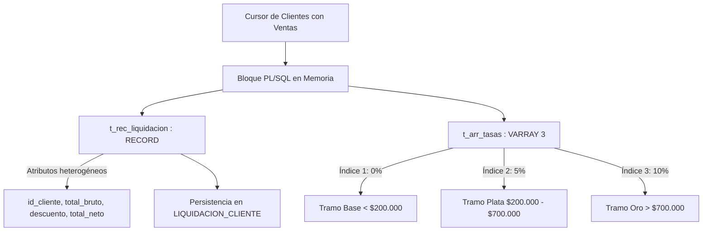
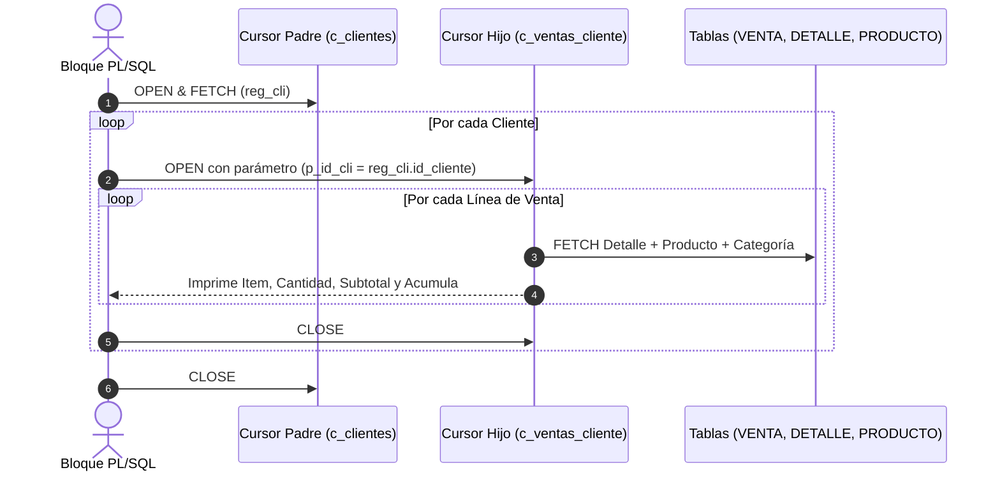
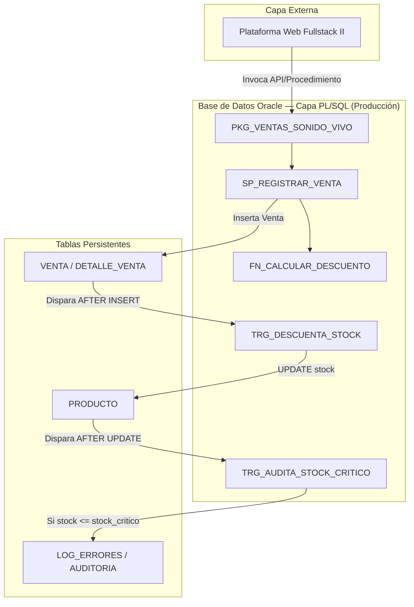

# INFORME TÉCNICO — EVALUACIÓN PARCIAL N° 1
## Caso de Análisis Semestral: Sonido Vivo

**Asignatura:** BDY1103 — Taller de Base de Datos  
**Carrera:** Ingeniería en Informática / Analista Programador Computacional  
**Institución:** Duoc UC  
**Proyecto:** Sistema de Procesamiento Transaccional y Liquidación de Ventas en Oracle PL/SQL  
**Sede / Ciudad:** Viña del Mar  
**Fecha:** Septiembre 2026  

---

## 1. Introducción

### 1.1 Descripción del Proyecto
**Sonido Vivo** es una tienda especializada en la comercialización de instrumentos musicales (guitarras, bajos, teclados, percusión) y equipamiento de audio profesional, ubicada en la ciudad de **Viña del Mar**. Su propuesta de valor abarca tanto a músicos aficionados como a profesionales de la región de Valparaíso.

El objetivo general del proyecto consiste en implementar una arquitectura transaccional sobre **Oracle Database**, automatizando los procesos críticos de gestión de inventario, cálculo consolidado de liquidaciones y auditoría mediante **PL/SQL**. El uso de PL/SQL permite encapsular las reglas del negocio directamente en el motor de base de datos, reduciendo el tráfico de red, eliminando desfases de concurrencia y garantizando transacciones seguras bajo el estándar ACID.

### 1.2 Alcance del Proyecto
El alcance de esta primera fase comprende:
- **Estructura Relacional:** Normalización y persistencia de catálogos (`CATEGORIA`, `PRODUCTO`), entidades comerciales (`CLIENTE`), transacciones (`VENTA`, `DETALLE_VENTA`) y entidades de control (`LIQUIDACION_CLIENTE`, `LOG_ERRORES`).
- **Lógica Procedural en Memoria:** Creación de bloques anónimos con estructuras de datos compuestas (`RECORD` y `VARRAY`) para la liquidación de beneficios comerciales.
- **Procesamiento Jerárquico:** Sincronización de información cabecera-detalle mediante cursores explícitos parametrizados en bucles anidados.
- **Gestión de Excepciones:** Control de integridad operativo capturando tanto errores nativos del motor Oracle como infracciones a las reglas de negocio de Sonido Vivo.
- **Proyección Arquitectónica:** Plan de evolución estratégica hacia una capa de subprogramas persistentes (`PROCEDURE`, `FUNCTION`, `PACKAGE`, `TRIGGER`) con miras a la integración con el ecosistema web de Fullstack II.

### 1.3 Tecnologías Utilizadas
- **Motor de Base de Datos:** Oracle Database 19c Enterprise Edition / Oracle Express Edition (XE).
- **Lenguajes:** Oracle SQL (DDL, DML) y PL/SQL (Procedural Language/SQL).
- **Herramienta de Desarrollo y Administración:** Oracle SQL Developer / Oracle LiveSQL.
- **Modelado:** Notación Chen / Relacional Crow's Foot.

### 1.4 Criterios de Modelado Relacional, 3FN y Concurrencia
Para asegurar robustez en el diseño de Sonido Vivo, se aplican las siguientes directrices arquitectónicas:
1. **Normalización y Justificación de 3FN (Snapshot Histórico):**
   El modelo relacional satisface la Tercera Forma Normal (3FN), eliminando dependencias transitivas en las entidades maestras (`CATEGORIA`, `PRODUCTO`, `CLIENTE`). No obstante, en la tabla de control `LIQUIDACION_CLIENTE`, el atributo `nombre_completo` se mantiene de forma desnormalizada deliberadamente bajo el patrón **Snapshot Histórico (Cierre Contable)**. Esto asegura que cada liquidación conserve inmutable el nombre del cliente vigente a la fecha de emisión, aislando el registro contable de eventuales modificaciones posteriores en la ficha maestra del cliente.
2. **Integridad Declarativa en Datos Calculados:**
   Para impedir inconsistencias aritméticas a nivel de motor, el DDL incorpora restricciones `CHECK` que obligan la correspondencia exacta de importes:
   - En `DETALLE_VENTA`: `CONSTRAINT chk_det_subtotal CHECK (subtotal_linea = cantidad * precio_unitario)`.
   - En `VENTA`: `CONSTRAINT chk_venta_totales CHECK (subtotal >= 0 AND descuento >= 0 AND total = (subtotal - descuento))`.
3. **Control de Concurrencia mediante Objetos SEQUENCE:**
   Se descarta el uso de `MAX(id) + 1` para la asignación de identificadores, dado que en entornos multiusuario provoca condiciones de carrera y fallos por clave duplicada (`ORA-00001`). En su lugar, se implementan objetos `SEQUENCE` de Oracle (`SEQ_LOG_ERRORES` y `SEQ_LIQUIDACION_CLIENTE`), garantizando asignación secuencial atómica y escalable.

---

## 2. Tipos de Datos Compuestos (RECORD y VARRAY)

### 2.1 Integración de RECORD y VARRAY en Sonido Vivo
En el procesamiento batch de liquidaciones comerciales, Sonido Vivo requiere manejar datos con distintas dimensiones y tipos:



- **`RECORD` (`t_rec_liquidacion`):** Permite unificar en una sola variable lógica atributos heterogéneos (identificador, nombre completo, total acumulado, porcentaje de descuento, monto descontado y observaciones). Esto evita declarar múltiples variables escalares sueltas y garantiza cohesión en el tratamiento del registro.
- **`VARRAY` (`t_arr_tasas`):** Define una colección de tamaño fijo (3 elementos) indexada secuencialmente en memoria PGA (*Program Global Area*), que almacena las tasas de descuento por volumen (0%, 5% y 10%).

### 2.2 Eficiencia del Procesamiento
1. **Reducción de I/O a Disco:** Al almacenar la matriz de descuentos en una colección `VARRAY` en memoria de sesión, el motor PL/SQL no necesita consultar repetidamente tablas de parámetros en disco durante la ejecución del bucle.
2. **Claridad Sintáctica y Mantenimiento:** La variable tipo `RECORD` actúa como un DTO (*Data Transfer Object*) nativo, simplificando los bloques `INSERT` y reduciendo el riesgo de discrepancias de tipos de datos mediante `%TYPE`.

---

## 3. Desarrollo de Bloques PL/SQL con Cursores Explícitos Complejos

### 3.1 Fundamentos de Cursores Explícitos
Un cursor explícito es un área de memoria de trabajo privada (área de contexto) creada por el desarrollador para almacenar el conjunto de filas devuelto por una consulta `SELECT` que retorna múltiples registros. Se utiliza obligatoriamente cuando se requiere control granular sobre el ciclo de vida de la consulta: `OPEN`, `FETCH` fila por fila y `CLOSE`.

### 3.2 Diferencia entre Cursores Simples y Complejos
- **Cursor Simple:** Consulta sobre una sola tabla, sin agregaciones ni filtros dinámicos, que usualmente recorre registros de manera lineal.
- **Cursor Complejo:** Integra múltiples cláusulas `JOIN` entre tablas relacionadas, condiciones de filtro contextuales, funciones de grupo (`SUM`, `COUNT`), subconsultas correlated y **parámetros de entrada**, lo que permite especializar el resultado según el contexto del flujo de ejecución.

### 3.3 Cursores Explícitos Parametrizados y Bucles Anidados
En Sonido Vivo se implementó un esquema de dos cursores coordinados:
1. **Cursor Padre (`c_clientes`):** Sin parámetros, recorre únicamente aquellos clientes que registran ventas en el sistema.
2. **Cursor Hijo (`c_ventas_cliente(p_id_cli)`):** Recibe como argumento formal el identificador del cliente actual (`reg_cli.id_cliente`) provisto por el bucle externo.



### 3.4 Ventajas de los Cursores Complejos en la Solución
- **Filtro en la Fuente:** El paso de parámetros delega el filtrado al optimizador de costos de Oracle (CBO), que aprovecha los índices primarios y foráneos (`fk_venta_cliente`, `fk_det_prod`).
- **Sincronización Natural:** Resuelve la relación jerárquica 1 a N (un cliente, muchas boletas, muchos ítems) sin necesidad de construir estructuras matriciales temporales en memoria ni generar productos cartesianos descontrolados.

---

## 4. Integración de Control de Excepciones

### 4.1 Excepciones Predefinidas de Oracle
Son errores internos del motor que cuentan con un código ORA predeterminado y un nombre estándar asignado por Oracle en el paquete `STANDARD`. En Sonido Vivo se capturan:
- **`NO_DATA_FOUND` (ORA-01403):** Se activa cuando una consulta `SELECT INTO` intenta buscar un cliente o producto por código/ID y este no existe en las tablas correspondientes.
- **`TOO_MANY_ROWS` (ORA-01422):** Se dispara si una consulta escalar retorna más de una fila, alertando inconsistencias de unicidad en catálogos.

### 4.2 Excepciones Personalizadas Definidas por el Usuario
Corresponden a reglas de negocio que no violan la sintaxis SQL ni las restricciones de tabla, pero sí infringen la lógica operativa de la tienda. Se declaran en la sección `DECLARE` con tipo `EXCEPTION` y se disparan explícitamente mediante la instrucción `RAISE`:
- **`e_stock_insuficiente`:** Se gatilla cuando un cliente intenta comprar una cantidad mayor a las unidades reales físicas disponibles en el inventario de Sonido Vivo (`v_cantidad_solicitada > v_stock_actual`).
- **`e_cantidad_invalida`:** Se activa si se envía una cantidad menor o igual a cero en la línea de detalle.

### 4.3 Integración Transaccional y Persistencia en `LOG_ERRORES`
El flujo transaccional implementa un ciclo completo ACID:
1. **Flujo Exitoso (Venta Concretada):** Una vez validadas la existencia del cliente, la validez de los parámetros y la suficiencia de stock, el bloque ejecuta la mutación efectiva del inventario:
   ```sql
   UPDATE PRODUCTO
   SET stock = stock - v_cantidad_solicitada
   WHERE id_producto = v_id_producto;
   COMMIT;
   ```
2. **Flujo de Excepción (Compensación y Auditoría):** Ante cualquier fallo o transgresión de regla de negocio (`e_stock_insuficiente`, `e_cantidad_invalida`, `NO_DATA_FOUND`):
   - Aplica `ROLLBACK` inmediato para revertir operaciones intermedias.
   - Obtiene el siguiente identificador correlativo atómicamente mediante `SEQ_LOG_ERRORES.NEXTVAL`, eliminando problemas de concurrencia.
   - Inserta una fila en la tabla de auditoría `LOG_ERRORES` registrando el código (`SQLCODE`), mensaje explicativo (`SQLERRM`), el módulo de origen y la marca temporal.
   - Mantiene trazabilidad total de incidentes sin provocar la caída abrupta de la sesión del cliente.

---

## 5. Evaluación de Procedimientos, Funciones, Paquetes y Triggers

### 5.1 Marco Teórico de Objetos Almacenados
- **Procedimiento Almacenado (`PROCEDURE`):** Bloque PL/SQL con nombre, compilado y persistido en el diccionario de datos. Ejecuta secuencias de operaciones DML/lógicas complejas. No está obligado a retornar un valor mediante la cláusula `RETURN`, pero puede usar parámetros `OUT` o `IN OUT`.
- **Función Almacenada (`FUNCTION`):** Subprograma orientado al cómputo y transformación de datos. Debe obligatoriamente retornar un valor tipado (`RETURN <tipo>`) y puede ser invocada directamente dentro de sentencias SQL (`SELECT`, `WHERE`).
- **Paquete (`PACKAGE`):** Unidad de encapsulación que agrupa procedimientos, funciones, tipos, cursores y variables relacionadas bajo dos componentes: la especificación (*Header* o interfaz pública) y el cuerpo (*Body* o implementación privada).
- **Disparador (`TRIGGER`):** Bloque de código asociado a una tabla o vista que se ejecuta automáticamente cuando ocurre un evento DML (`INSERT`, `UPDATE`, `DELETE`) o DDL, pudiendo actuar a nivel de sentencia o por cada fila afectada (`FOR EACH ROW`).

### 5.2 Estrategia de Implementación Futura en Sonido Vivo



1. **Paquete `PKG_VENTAS_SONIDO_VIVO`:** Encapsulará todas las operaciones del ciclo comercial. Oculta la complejidad de las consultas internas y expone únicamente las firmas de registro y anulación.
2. **Función `FN_CALCULAR_DESCUENTO`:** Calculará el porcentaje y monto rebajado en función del historial del cliente y el monto de la boleta.
3. **Procedimiento `SP_REGISTRAR_VENTA`:** Orquestará la creación atómica de la cabecera y sus líneas de detalle.
4. **Trigger `TRG_DESCUENTA_STOCK`:** Descontará automáticamente las existencias de `PRODUCTO` ante cada inserción en `DETALLE_VENTA`.
5. **Trigger `TRG_AUDITA_STOCK_CRITICO`:** Verificará si el nuevo stock cae por debajo de `stock_critico`; de ser así, insertará una alerta automática en la tabla de incidencias para reabastecimiento en Viña del Mar.

### 5.3 Análisis Crítico: Beneficios, Riesgos y Mitigaciones
| Elemento | Beneficio Principal | Riesgo Potencial | Estrategia de Mitigación |
|---|---|---|---|
| **Procedimientos y Funciones** | Reutilización masiva de código; mantenimiento centralizado en un único punto. | Sobrecarga de memoria PGA si se abusa de parámetros gigantes. | Paso de parámetros por referencia (`NOCOPY`) en colecciones grandes. |
| **Paquetes** | Compilación modular: modificar el body no invalida objetos dependientes; gestión de estado privado. | Dependencias circulares entre paquetes mal desacoplados. | Aplicar principio de responsabilidad única (un paquete por dominio de negocio). |
| **Triggers** | Garantía irrestricta de auditoría e integridad sin depender de la aplicación cliente. | Efectos colaterales ocultos (*hidden logic*), degradación de rendimiento masivo en DML por lotes y error de tabla mutante (`ORA-04091`). | Limitar triggers exclusivamente a auditoría y cálculos derivados atómicos; evitar consultas cruzadas a la misma tabla mutante usando triggers compuestos (*Compound Triggers*). |

---

## 6. Conclusión

### 6.1 Resumen
El desarrollo demostró la viabilidad y robustez de utilizar **Oracle PL/SQL** como motor transaccional para la tienda **Sonido Vivo** en Viña del Mar. Se implementaron con éxito bloques anónimos que resuelven requerimientos reales de negocio utilizando tipos compuestos (`RECORD` y `VARRAY`), bucles anidados con cursores explícitos parametrizados y un esquema formal de captura y persistencia de excepciones.

### 6.2 Impacto en el Negocio
- **Eliminación del Quiebre de Stock Ciego:** Las validaciones atómicas impiden vender unidades que no existen físicamente en bodega.
- **Fidelización Automatizada:** El motor de liquidaciones premia automáticamente el volumen de compra y la categoría del cliente sin intervención manual.
- **Auditoría Transparente:** Cada error operacional queda registrado en `LOG_ERRORES`, permitiendo a la administración detectar intentos de venta fallidos o códigos obsoletos.

### 6.3 Recomendaciones para la Siguiente Etapa
- Migrar los bloques anónimos a los paquetes compilados propuestos (`PKG_VENTAS_SONIDO_VIVO`).
- Exponer las rutinas PL/SQL mediante servicios REST utilizando **Oracle REST Data Services (ORDS)** para conectar de forma nativa la tienda web desarrollada en **Fullstack II**.

---

## 7. Anexos: Código Fuente Completo

### Anexo A: Script DDL y Carga Inicial (`01_esquema_y_datos.sql`)
*(Ubicado en el repositorio en `scripts/01_esquema_y_datos.sql`)*

### Anexo B: Bloque con RECORD y VARRAY (`02_bloque_record_varray.sql`)
*(Ubicado en el repositorio en `scripts/02_bloque_record_varray.sql`)*

### Anexo C: Bloque con Cursores Anidados (`03_bloque_cursores_anidados.sql`)
*(Ubicado en el repositorio en `scripts/03_bloque_cursores_anidados.sql`)*

### Anexo D: Bloque con Control de Excepciones (`04_bloque_excepciones.sql`)
*(Ubicado en el repositorio en `scripts/04_bloque_excepciones.sql`)*
