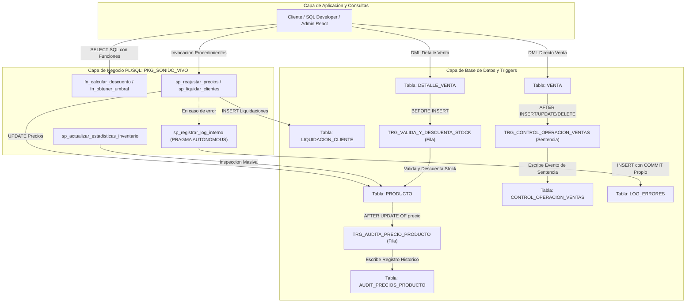

# Informe Tecnico: Implementacion de Programas PL/SQL en una Base de Datos

**Asignatura:** Taller de Base de Datos (BDY1103)  
**Evaluacion:** Evaluacion Parcial N° 2 (Situacion Evaluativa 1 - Entrega por Encargo)  
**Institucion:** Duoc UC  
**Proyecto:** Sonido Vivo — Sistema de Gestion Comercial e Inventario de Instrumentos Musicales (Viña del Mar)  
**Docente:** Evaluador de Asignatura  
**Fecha:** Octubre 2026  

---

## 1. Introduccion

### 1.1 Descripcion del Proyecto
Sonido Vivo es una empresa dedicada a la comercializacion mayorista y minorista de instrumentos musicales, amplificacion y audio profesional con sede central en la ciudad de Viña del Mar. Tras la implementacion del modelo relacional en la Evaluacion Parcial 1, el negocio evidencio cuellos de botella criticos en tres areas:
1. Desactualizacion manual y dispersa de las listas de precios comerciales por categoria.
2. Quiebres de stock en bodega generados por ventas simultaneas no validadas en tiempo real.
3. Liquidaciones mensuales de clientes con calculos manuales propensos a errores en la aplicacion de escalas de descuento y bonos de fidelizacion.

El presente proyecto implementa una arquitectura modular de programas almacenados permanentes en Oracle Database mediante PL/SQL (Packages, Procedimientos, Funciones y Triggers). Estos objetos encapsulan las politicas comerciales, garantizan la integridad de inventario de forma reactiva y centralizan el procesamiento masivo directamente dentro del motor de base de datos.

### 1.2 Alcance del Proyecto
El alcance de esta etapa abarca los siguientes componentes y procesos de negocio:
- **Bodega e Inventario:** Control automatizado e inmediato de existencias durante la emision de ordenes de venta, previniendo sobreventas y registrando inspecciones periodicas de articulos bajo nivel critico.
- **Politica de Precios y Auditoria Forense:** Mecanismo transaccional para aplicar reajustes masivos por categoria de productos, garantizando trazabilidad total de cualquier alteracion de precios (usuario, fecha, valor anterior y nuevo).
- **Fidelizacion y Cierre Mensual:** Automatizacion del proceso de liquidacion comercial acumulada para clientes registrados, calculando tasas de descuento por volumen y bonificaciones especiales para clientes de categoria PREMIUM.
- **Interoperabilidad:** Exposicion de contratos modulares aptos para ser consumidos tanto por sentencias SQL nativas como por capas de servicios backend externas.

### 1.3 Tecnologias Utilizadas
- **Motor de Base de Datos:** Oracle Database 19c / 21c Enterprise y Express Edition (XE).
- **Entorno de Desarrollo y Gestion:** Oracle SQL Developer y PL/SQL Command Line (SQL*Plus).
- **Lenguaje de Programacion Transaccional:** PL/SQL (Procedural Language for SQL), utilizando cursores explicitos, directivas de compilacion autonoma (`PRAGMA AUTONOMOUS_TRANSACTION`), triggers de fila/sentencia y paquetes compilados en el catalogo de datos.
- **Entorno de Integracion Externa:** Backend en Python (FastAPI con `python-oracledb` en Modo Thin) y Dashboard Administrativo en React 18 (`sonido-vivo-react`).

---

## 2. Desarrollo de Procedimientos y Funciones

### 2.1 Definicion y Caracteristicas
- **Procedimientos Almacenados:** Son bloques de codigo con nombre compilados y almacenados de manera permanente en el diccionario de datos de Oracle. Estan disenados para ejecutar acciones transaccionales masivas (`INSERT`, `UPDATE`, `DELETE`) o tareas operativas de administracion. No retornan un valor en su declaracion de cabecera, pero pueden comunicar multiples resultados hacia el entorno invocador mediante parametros con modo `OUT` o `IN OUT`.
- **Funciones Almacenadas:** Son subprogramas disenados fundamentalmente para efectuar calculos, validaciones o transformaciones logicas sobre los datos. Estan obligadas a retornar un unico valor tipado mediante la clausula `RETURN`. Cuando respetan las normas de pureza transaccional (no alterar tablas de la base de datos ni el estado del paquete), pueden ser embebidas directamente dentro de sentencias `SELECT`, `WHERE` u `ORDER BY`.

### 2.2 Ventajas y Desventajas

| Tipo de Subprograma | Ventajas Principales | Desventajas o Restricciones |
| :--- | :--- | :--- |
| **Procedimiento** | - Capacidad para modificar multiples tablas atomicamente.<br>- Retorno de multiples valores o colecciones via parametros `OUT`.<br>- Excelente control sobre ciclos de `COMMIT` y `ROLLBACK`. | - No pueden ser invocados directamente dentro de una clausula `SELECT` de SQL.<br>- Requieren un bloque PL/SQL o llamada externa formal (`CALL` / `EXEC`). |
| **Funcion** | - Alta reusabilidad dentro de consultas SQL y vistas analiticas.<br>- Encapsula formulas matematicas y reglas de negocio deterministas.<br>- Simplifica el codigo del cliente al devolver un resultado directo. | - Restricciones de pureza (no deben emitir DML si se consumen desde consultas SQL regulares).<br>- Solo pueden retornar un valor en su firma principal. |

### 2.3 Proposito en el Contexto del Proyecto Sonido Vivo
En Sonido Vivo, los procedimientos se orientaron a las tareas pesadas de mantenimiento y actualizacion masiva que exigen transaccionalidad estricta (reajustar el catalogo de guitarras, consolidar stocks de articulos criticos y emitir el cierre mensual de liquidaciones). Las funciones se destinaron a centralizar las reglas de calculo de tramos de descuento y lectura de politicas comerciales, permitiendo que tanto el paquete, los bloques de reporte y las consultas directas de administracion obtengan calculos consistentes sin duplicar codigo.

### 2.4 Demostracion y Uso en el Proyecto Semestral

#### A. Funciones Implementadas (Con y Sin Parametros)
1. **Funcion con Parametros (`fn_calcular_descuento`):** Recibe el total bruto acumulado y el tipo de cliente (`ESTANDAR`, `FRECUENTE`, `PREMIUM`). Evalua los tramos comerciales (< $200.000 = 0%, $200.000 a $700.000 = 5%, > $700.000 = 10%) e inyecta un 2% adicional si el cliente ostenta membresia PREMIUM.
2. **Funcion sin Parametros (`fn_obtener_umbral_descuento`):** Retorna el valor constante de `$200.000` CLP, garantizando que el umbral de entrada a descuentos este gobernado desde el servidor.

**Uso de Funciones en Sentencias SQL Nativas:**
```sql
SELECT 
    c.rut,
    c.nombres || ' ' || c.apellidos AS cliente,
    c.tipo_cliente,
    v.id_venta,
    v.total AS monto_venta,
    PKG_SONIDO_VIVO.fn_calcular_descuento(v.total, c.tipo_cliente) AS pct_descuento,
    ROUND(v.total * (PKG_SONIDO_VIVO.fn_calcular_descuento(v.total, c.tipo_cliente) / 100)) AS monto_descuento_pesos,
    PKG_SONIDO_VIVO.fn_obtener_umbral_descuento() AS umbral_minimo
FROM VENTA v
INNER JOIN CLIENTE c ON v.id_cliente = c.id_cliente
WHERE v.estado_venta = 'LIQUIDADA';
```

#### B. Procedimientos Implementados (Con y Sin Parametros)
1. **Procedimiento con Parametros (`sp_reajustar_precios`):** Recibe el porcentaje y la categoria objetivo. Aplica el incremento mediante `UPDATE`, extrae `SQL%ROWCOUNT` y devuelve las tuplas alteradas a traves del parametro `OUT p_filas_afectadas`.
2. **Procedimiento con Parametros (`sp_liquidar_clientes`):** Recibe el periodo contable en formato `YYYY-MM`. Abre un cursor explicito agrupado sobre las ventas cerradas del periodo, calcula los descuentos invocando a `fn_calcular_descuento` e inserta los registros resultantes en `LIQUIDACION_CLIENTE`, devolviendo el conteo final en `p_filas_liquidadas`.
3. **Procedimiento sin Parametros (`sp_actualizar_estadisticas_inventario`):** No requiere parametros de entrada. Realiza una inspeccion completa sobre la tabla `PRODUCTO` y registra de forma automatica en `HISTORIAL_STOCK` todos los articulos que se encuentren en o por debajo de su umbral critico.

---

## 3. Desarrollo de Packages

### 3.1 Definicion y Caracteristicas
Un paquete (Package) en PL/SQL es una estructura modular que agrupa logicamente tipos de datos, variables, constantes, cursores, excepciones, procedimientos y funciones relacionados. Se compone de dos partes estrictamente diferenciadas e independientes en su compilacion:
1. **Package Specification (Especificacion):** Representa la interfaz publica del modulo. Declara unicamente los elementos que seran accesibles para los usuarios y aplicaciones autorizadas.
2. **Package Body (Cuerpo):** Contiene la implementacion de todos los elementos declarados en la especificacion, asi como definiciones de variables, funciones y procedimientos privados que no son expuestos hacia el exterior.

### 3.2 Ventajas y Desventajas al Utilizar Packages

| Aspecto | Ventajas | Consideraciones / Desventajas |
| :--- | :--- | :--- |
| **Modularidad** | Agrupa toda la logica de un dominio (ej. Sonido Vivo) en una unidad coherente y facil de mantener. | Si la especificacion cambia, todos los objetos dependientes quedan invalidados y requieren recompilacion. |
| **Encapsulamiento** | Oculta la complejidad interna y permite declarar constructores privados inaccesibles para el usuario comun. | Requiere un diseno riguroso de arquitectura previo para no acumular rutinas no relacionadas en un mega-paquete. |
| **Rendimiento** | **Carga unica en memoria (Shared Pool):** Al invocar cualquier miembro del paquete por primera vez, Oracle carga el paquete completo en memoria. Las subsiguientes llamadas son instantaneas. | Mayor consumo inicial de memoria en el SGA de Oracle si el cuerpo del paquete es sumamente extenso. |
| **Seguridad** | Facilita la concesion de privilegios: se otorga permiso `EXECUTE` sobre el paquete en lugar de otorgar permisos tabla por tabla. | Requiere gestionar roles de ejecucion definidos (`AUTHID DEFINER` vs `AUTHID CURRENT_USER`). |

### 3.3 Como los Packages Ayudan a Organizar el Codigo y se Relacionan con Subprogramas
En proyectos de envergadura, tener decenas de procedimientos y funciones sueltas provoca desorden en el diccionario de datos, colisiones de nombres y dificultad para auditar permisos. El package `PKG_SONIDO_VIVO` unifica todas las operaciones de la tienda bajo un mismo espacio de nombres (`PKG_SONIDO_VIVO.*`). Ademas, permite que las funciones y procedimientos compartan constantes globales (como `c_version`) y llamen a subprogramas utilitarios comunes sin exponerlos al exterior.

### 3.4 Demostracion y Constructores Publicos vs Privados en Sonido Vivo

- **Constructores Publicos:** Declarados en la especificacion:
  - `fn_calcular_descuento`
  - `fn_obtener_umbral_descuento`
  - `sp_reajustar_precios`
  - `sp_liquidar_clientes`
  - `sp_actualizar_estadisticas_inventario`
- **Constructor Privado (`sp_registrar_log_interno`):**
  Definido exclusivamente en el `PACKAGE BODY`. Su proposito es registrar cualquier fallo en `LOG_ERRORES`. Al no estar declarado en la especificacion, ningun usuario externo o hacker puede invocarlo directamente ni alterar el registro de errores. Ademas, utiliza la directiva `PRAGMA AUTONOMOUS_TRANSACTION`, garantizando que el log de auditoria se guarde con un `COMMIT` propio e independiente, aun cuando la operacion comercial principal sufra un `ROLLBACK`.

```sql
-- Fragmento del Constructor Privado en PKG_SONIDO_VIVO BODY
PROCEDURE sp_registrar_log_interno(
    p_modulo_origen IN VARCHAR2,
    p_codigo_error  IN VARCHAR2,
    p_mensaje_error IN VARCHAR2
) IS
    PRAGMA AUTONOMOUS_TRANSACTION;
BEGIN
    INSERT INTO LOG_ERRORES (
        id_log, codigo_error, mensaje_error, modulo_origen, usuario_bd, fecha_registro
    ) VALUES (
        SEQ_LOG_ERRORES.NEXTVAL, p_codigo_error, SUBSTR(p_mensaje_error, 1, 400), p_modulo_origen, USER, SYSDATE
    );
    COMMIT;
EXCEPTION
    WHEN OTHERS THEN
        ROLLBACK;
END sp_registrar_log_interno;
```

---

## 4. Desarrollo de Triggers

### 4.1 Definicion y Caracteristicas
Un Trigger (Disparador) es un bloque PL/SQL asociado a una tabla, vista o evento de base de datos que se ejecuta de forma automatica e implicita cuando ocurre una operacion DML (`INSERT`, `UPDATE`, `DELETE`) o DDL especifica.
- **Trigger a Nivel de Fila (`FOR EACH ROW`):** Se dispara de forma iterativa por cada fila individual que resulte afectada por la sentencia DML. Tiene acceso a los valores de las columnas mediante las pseudocolumnas `:OLD` (valor previo) y `:NEW` (valor propuesto).
- **Trigger a Nivel de Sentencia (sin `FOR EACH ROW`):** Se ejecuta exactamente una sola vez por cada sentencia emitida, independientemente de que la operacion impacte a 0, 1 o 10.000 filas. No tiene acceso a pseudocolumnas individuales y se emplea para auditoria global, balanceo transaccional o restriccion de horarios.

### 4.2 Ventajas y Desventajas de la Utilizacion de Triggers

| Ventajas | Desventajas y Riesgos |
| :--- | :--- |
| **Garantia de Integridad Inquebrantable:** Se ejecuta siempre, sin importar si la modificacion proviene de una aplicacion web, una consola SQL o un script batch. | **Riesgo de Tabla Mutante (`ORA-04091`):** Ocurre si un trigger de fila intenta consultar la misma tabla que esta sufriendo la modificacion en curso. |
| **Auditoria Invisible e Inviolable:** Los usuarios no pueden eludir el registro de auditoria, ya que este corre por debajo de la transaccion. | **Impacto en el Rendimiento:** Operaciones masivas de millones de filas pueden verse ralentizadas si los triggers ejecutan consultas pesadas por cada fila. |
| **Prevencion Inmediata de Errores:** Permite cancelar transacciones invalidas en el momento exacto usando `RAISE_APPLICATION_ERROR`. | **Dificultad de Depuracion:** Su ejecucion oculta ("efecto secundario") puede desorientar a desarrolladores si no estan debidamente documentados. |

### 4.3 Proposito y Demostracion en el Contexto de Sonido Vivo

#### A. Trigger de Fila 1: Validacion y Descuento Automatico de Stock
- **Nombre:** `TRG_VALIDA_Y_DESCUENTA_STOCK`
- **Momento y Evento:** `BEFORE INSERT ON DETALLE_VENTA FOR EACH ROW`
- **Mecanica:** Antes de persistir una nueva linea de venta, consulta la tabla `PRODUCTO`. Si el stock disponible es menor a `:NEW.cantidad`, ejecuta `RAISE_APPLICATION_ERROR(-20001, ...)`, abortando la transaccion y evitando la sobreventa. Si hay existencias, aplica un `UPDATE PRODUCTO SET stock = stock - :NEW.cantidad`.

#### B. Trigger de Fila 2: Auditoria Forense de Modificaciones de Precio
- **Nombre:** `TRG_AUDITA_PRECIO_PRODUCTO`
- **Momento y Evento:** `AFTER UPDATE OF precio ON PRODUCTO FOR EACH ROW WHEN (NEW.precio <> OLD.precio)`
- **Mecanica:** Gracias a la clausula `WHEN`, solo se activa si el precio sufre una variacion real. Extrae `:OLD.precio`, `:NEW.precio`, la fecha y el usuario actual (`USER`), registrando la evidencia en la tabla `AUDIT_PRECIOS_PRODUCTO`.

#### C. Trigger de Sentencia: Control de Eventos Transaccionales sobre Ventas
- **Nombre:** `TRG_CONTROL_OPERACION_VENTAS`
- **Momento y Evento:** `AFTER INSERT OR UPDATE OR DELETE ON VENTA` (A nivel de sentencia, sin `FOR EACH ROW`)
- **Mecanica:** Se ejecuta una unica vez por sentencia. Evalua las variables booleanas condicionales (`INSERTING`, `UPDATING`, `DELETING`), obtiene el conteo global de ventas y registra la operacion en la tabla `CONTROL_OPERACION_VENTAS`.

---

## 5. Conclusion

### 5.1 Resumen
La transicion desde los bloques anonimos de la Evaluacion Parcial 1 hacia una arquitectura estructurada de subprogramas permanentes y triggers en la Evaluacion Parcial 2 permitio consolidar las reglas de negocio de Sonido Vivo dentro del motor de base de datos. Se dio cumplimiento exhaustivo a cada exigencia de la pauta de evaluacion:
- Implementacion de procedimientos con y sin parametros para mantenimiento de precios, auditoria preventiva y liquidacion masiva.
- Implementacion de funciones con y sin parametros consumidas tanto en logica procedural como directamente en sentencias `SELECT` de SQL.
- Diseno del package `PKG_SONIDO_VIVO` con constructores publicos y privados, utilizando transacciones autonomas (`PRAGMA AUTONOMOUS_TRANSACTION`) para el aislamiento de errores en `LOG_ERRORES`.
- Diseno de disparadores reactivos a nivel de fila (stock y auditoria de precio) y a nivel de sentencia (control transaccional de ventas).

### 5.2 Impacto del Proyecto
1. **Consistencia Transaccional:** La bodega de instrumentos musicales queda blindada ante sobreventas en concurrencia gracias a los triggers de fila.
2. **Eficiencia en el Procesamiento:** Los procesos masivos de reajuste y liquidacion se ejecutan en milisegundos en la capa de datos, evitando transferir millones de registros por la red hacia servidores de aplicacion.
3. **Mantenibilidad y Seguridad:** Las directivas de precios y tramos de descuento residen centralizadas en el paquete; cualquier ajuste comercial futuro se realiza en el `PACKAGE BODY` sin requerir modificaciones en las interfaces cliente.

### 5.3 Recomendaciones Futuras
- **Implementacion de Trabajos Programados (`DBMS_SCHEDULER`):** Automatizar la ejecucion del procedimiento sin parametros `sp_actualizar_estadisticas_inventario` y del procedimiento de liquidacion mensual para que corran de manera nocturna sin intervencion humana.
- **Particionamiento de Tablas Historicas:** Implementar particionamiento por rangos de fecha (`RANGE PARTITIONING`) sobre las tablas de auditoria (`AUDIT_PRECIOS_PRODUCTO` y `HISTORIAL_STOCK`) para sostener un alto rendimiento a medida que los registros alcancen cientos de miles de entradas.
- **Ampliacion de Triggers DDL / Sistema:** Incorporar disparadores a nivel de base de datos (`AFTER LOGON`, `BEFORE DDL`) para auditar intentos no autorizados de modificacion de tablas o accesos fuera de horarios habiles.

---

## 6. Anexos

### 6.1 Diagrama de Arquitectura y Flujo de Interaccion
El siguiente diagrama sintetiza el comportamiento integrado de la solucion:



### 6.2 Script SQL Completo de Implementacion
El codigo completo y ejecutable se encuentra incorporado en el repositorio institucional en el archivo:
- `prueba parcial 2/scripts/01_paquetes_y_triggers_ep2.sql`
